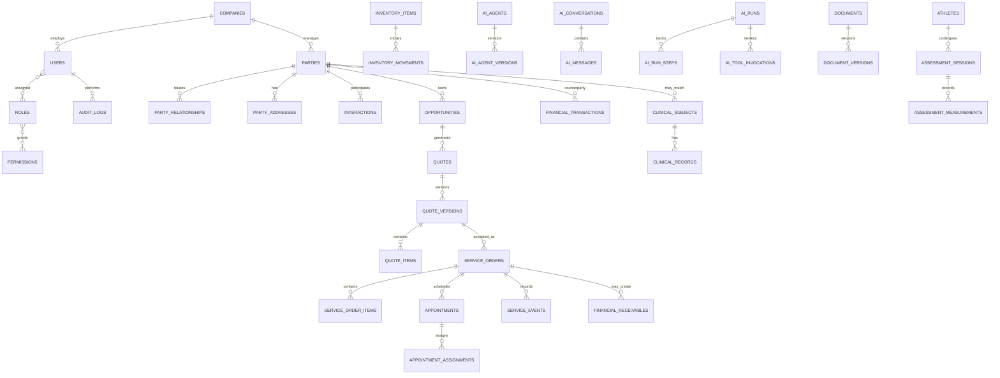

# INGENERIA JARVIS — DATABASE SPECIFICATION

**Proyecto:** INGENERIA JARVIS / ERGO JARVIS  
**Organización inicial:** Ergo SaniTas SpA  
**Documento:** Especificación lógica y física preliminar de la base de datos  
**Versión:** 1.1.0  
**Estado:** Diseño técnico para revisión antes de generar migraciones  
**Fecha:** 11 de octubre de 2026 (actualizada 15 de octubre de 2026)  
**Decisiones vinculantes:** `DECISIONS.md` (este documento define los nombres de campos; los enums y transiciones canónicos están allí)  
**Motor objetivo:** MySQL 8.0.16 o superior (InnoDB)  
**Backend:** Laravel API  
**Aplicación:** React + Vite + TypeScript  
**Idioma y zona horaria de negocio:** Español, `America/Santiago`  
**Moneda predeterminada:** CLP  
**Documentos padre:** `INGENERIA_JARVIS_MASTER_SPEC.md` y `PRODUCT_REQUIREMENTS.md`

> Este documento define el modelo objetivo. No afirma que las tablas existan en una instalación actual. Antes de producción deben revisarse las políticas de acceso, retención de datos, procesos reales, obligaciones aplicables y requisitos específicos de Ergo SaniTas SpA. El MVP debe utilizar datos sintéticos.

---

## 1. Propósito

Definir una estructura consistente, normalizada, auditable y extensible para sostener la gestión empresarial de Ergo SaniTas SpA. La base debe conectar clientes, servicios, oportunidades, cotizaciones, agenda, órdenes de servicio y, progresivamente, finanzas, inventario, documentos, recursos humanos, datos clínicos, evaluaciones deportivas y agentes de inteligencia artificial.

La base de datos es una fuente de datos estructurados; no es por sí sola un mecanismo suficiente de autorización. Toda lectura y escritura protegida debe pasar por Laravel, con Policies/Services, validación y auditoría según el caso.

### 1.1 Objetivos de diseño

- Mantener una única referencia para personas, organizaciones, contactos y ubicaciones.
- Evitar duplicación entre CRM, ventas y operaciones.
- Preservar historial de cotizaciones, cambios de precios y estados de órdenes.
- Distinguir hechos confirmados, cálculos y proyecciones.
- Preservar la trazabilidad de operaciones financieras y de inventario.
- Separar lógicamente los datos clínicos de la información comercial.
- Ejecutar operaciones relacionadas dentro de transacciones de base de datos.
- Restringir la información que se ofrece a los agentes de IA.
- Permitir evolución mediante migraciones versionadas sin depender de cambios manuales en producción.

### 1.2 Fuera del alcance de este documento

- Migraciones Laravel ya ejecutadas.
- Procedimientos contables o tributarios oficiales completos.
- Un repositorio de archivos binarios dentro de MySQL.
- Un sistema clínico certificado o una autorización para tratar datos sanitarios reales.
- Integraciones cuya API, credenciales, proveedor o términos todavía no estén confirmados.
- Decisiones legales definitivas sobre bases de licitud, plazos de conservación o eliminación de cada dato.

---

## 2. Principios técnicos y convenciones

### 2.1 Motor y transacciones

- Motor de almacenamiento: InnoDB.
- Codificación: `utf8mb4`; collation elegida y documentada, preferentemente una collation Unicode compatible con búsquedas en español.
- Tablas operacionales con claves foráneas reales, índices y restricciones cuando proceda.
- Usar transacciones Laravel para procesos que creen o actualicen varias entidades relacionadas.
- No utilizar `MyISAM` para datos operacionales.
- No usar SQL concatenado con datos externos; utilizar consultas parametrizadas/Eloquent.

### 2.2 Claves primarias y referencias públicas

- Clave primaria interna: `BIGINT UNSIGNED AUTO_INCREMENT` (`id`) como valor predeterminado para entidades operacionales.
- Añadir `public_id CHAR(26)` ULID único a entidades expuestas por API cuando se requiera evitar exponer secuencias. Generarlo en la aplicación.
- No usar RUT, correo, teléfono ni nombre como clave primaria.
- Claves foráneas con nombre consistente: `<tabla_singular>_id`.
- Para registros de gran sensibilidad puede exponerse únicamente ULID/UUID opaco, pero los identificadores opacos no sustituyen la autorización.
- Las tablas puente deben tener clave primaria propia o clave compuesta cuando la unicidad de la relación sea inequívoca.

### 2.3 Campos comunes

En las tablas que representen entidades mantenibles se recomienda:

```text
id                  BIGINT UNSIGNED PK
public_id           CHAR(26) NULL UNIQUE, cuando se exponga por API
created_at          TIMESTAMP NULL
updated_at          TIMESTAMP NULL
created_by          BIGINT UNSIGNED NULL FK users.id, cuando la autoría sea relevante
updated_by          BIGINT UNSIGNED NULL FK users.id, cuando la autoría sea relevante
```

No añadir automáticamente todos estos campos a tablas append-only o de gran volumen si la duplicación resulta contraproducente. Los eventos de auditoría deben ser append-only. En algunas entidades se agregará `deleted_at TIMESTAMP NULL`, pero el borrado lógico se define por dominio y no es obligatorio para todas las tablas.

### 2.4 Tipos recomendados

| Uso | Tipo MySQL recomendado | Regla |
|---|---|---|
| Identificador interno | `BIGINT UNSIGNED` | Clave primaria o foránea |
| Identificador público | `CHAR(26)` | ULID generado por aplicación |
| Texto corto | `VARCHAR(n)` | Longitud explícita y validación |
| Texto largo | `TEXT` / `MEDIUMTEXT` | Solo para contenido textual justificado |
| Importe | `DECIMAL(14,2)` | Nunca `FLOAT`/`DOUBLE` para dinero |
| Precio o costo unitario | `DECIMAL(14,4)` | Redondeo a la escala de la moneda al calcular totales |
| Porcentaje | `DECIMAL(7,4)` | Documentar escala y fórmula |
| Mediciones | `DECIMAL(14,4)` u otra precisión documentada | Unidad obligatoria en dato o definición |
| Fecha de negocio | `DATE` | Para vencimiento/fecha sin hora |
| Hora local | `TIME` | Solo para hora recurrente o una hora sin fecha |
| Instante | `DATETIME(3)` / `TIMESTAMP(3)` | Guardar con política temporal uniforme |
| Bandera | `BOOLEAN` / `TINYINT(1)` | No usar como sustituto de un flujo de estados |
| Datos estructurados opcionales | `JSON` | Solo configuración/snapshot, validado en backend |
| Hash de archivo | `CHAR(64)` | SHA-256 hexadecimal |
| Dirección IP | `VARBINARY(16)` o representación validada | Nunca confiar en encabezados no verificados |

### 2.5 Estados

- Persistir estados como `VARCHAR(32)` o `VARCHAR(40)` y validarlos con enums respaldados en PHP y reglas de transición en Services.
- Utilizar `CHECK` de MySQL para invariantes simples cuando sean compatibles con la versión desplegada.
- Mantener catálogos cuando los valores deban ser configurables por negocio.
- No cambiar el estado desde una petición arbitraria: invocar una acción de dominio que compruebe transición, permisos y requisitos previos.
- Documentar cada estado, transición permitida y efecto secundario.

### 2.6 Dinero, moneda y precisión

- Guardar importes con `DECIMAL`, con moneda asociada (`currency CHAR(3)`, por defecto `CLP`).
- No asumir que todos los valores futuros estarán en CLP, aunque sea la moneda inicial.
- Mantener cantidades, precio unitario, descuentos, impuestos y totales por separado para explicar el resultado.
- Política de redondeo (`DECISIONS.md` DEC-005): half-up a la escala de la moneda; **CLP = 0 decimales**, CLF (UF) = 4, otras = 2. El IVA autoritativo se calcula a nivel de documento sobre el neto gravado. `tax_rate` se guarda como porcentaje (`19.0000`).
- Un valor en cotización no equivale a ingreso facturado ni a dinero recibido.

### 2.7 Tiempos y fechas

- La zona horaria de negocio es `America/Santiago`.
- Guardar instantes en UTC en `DATETIME(3)` o aplicar una política UTC consistente y probada para el motor; convertir a la zona de negocio en la capa de aplicación.
- Guardar la zona IANA usada en eventos externos cuando haga falta reproducir una programación.
- Las citas almacenan inicio y término como instantes, además de la zona usada para mostrarlos.
- No almacenar una fecha futura interpretada como “local” sin una regla de conversión clara.

### 2.8 Borrado, archivo e historia

- Catálogos pueden usar `deleted_at` si la eliminación lógica es segura.
- Clientes, cotizaciones aceptadas, órdenes, movimientos de inventario, documentos firmados, pagos y datos clínicos cerrados no deben desaparecer por borrado silencioso.
- Preferir `archived_at`, cancelación con motivo, reversa o evento de corrección trazable.
- Las reglas de retención y eliminación se deben configurar por clase de dato antes de producción.
- Para correcciones clínicas o financieras conservar el dato original y su enmienda conforme a reglas del dominio; no sobrescribir historia sin registro.

### 2.9 Multiempresa y sedes

La instancia inicial es para Ergo SaniTas SpA. Incluir `company_id` en los dominios donde ayude a separar datos y permita crecimiento futuro, pero no afirmar que existe multitenencia completa hasta probar aislamiento entre compañías en todas las rutas, consultas, trabajos en segundo plano y herramientas de IA. El `company_id` inicial apuntará a una fila de `companies` correspondiente a Ergo SaniTas SpA.

---

## 3. Contexto de dominios y fases

### 3.1 Dominios

1. Identidad y autorización.
2. Organización y CRM.
3. Catálogo de servicios y precios.
4. Oportunidades y ventas.
5. Cotizaciones y versiones.
6. Agenda y órdenes de servicio.
7. Finanzas administrativas.
8. Inventario, compras y equipos.
9. Documentos.
10. Personas y capacitación.
11. Datos clínicos restringidos.
12. Medicina deportiva y evaluaciones.
13. Agentes, conversaciones y ejecución.
14. Automatización, tareas y notificaciones.
15. Auditoría, seguridad e integración.

### 3.2 Fases de habilitación

- **Fase 0 — MVP** (`DECISIONS.md` DEC-002):
  - *MVP-1 núcleo:* empresa, usuarios, roles/permisos, auditoría, `approvals`, `idempotency_keys`, `document_sequences`.
  - *MVP-2 comercial-operativo:* CRM, catálogo, oportunidades, cotizaciones, agenda, órdenes, tareas, `staff_profiles`, `staff_availability`, `appointment_assignments` y documentos administrativos (`documents`, `document_versions`, `document_relations`, sin sensibilidad `CLINICAL`).
  - *MVP-3 IA:* `ai_model_profiles`, `ai_agents`, `ai_agent_versions`, `ai_conversations`, `ai_messages`, `ai_runs`, `ai_run_steps`, `ai_tool_invocations`, `prompt_templates`, `automation_workflows`, `automation_runs`, `scheduled_jobs`.
- **Fase 1 — operación ampliada:** finanzas administrativas, proveedores, solicitudes de compra, inventario y activos.
- **Fase 2 — IA ampliada:** base de conocimiento (`knowledge_documents`, `knowledge_chunks`), nuevos agentes y herramientas.
- **Fase 3 — personas y cumplimiento:** perfiles de personal, disponibilidad, capacitación y obligaciones/riesgos.
- **Fase 4 — clínica y rendimiento:** datos sanitarios y medicina deportiva, después de aprobar diseño de acceso, retención, consentimiento/base legal y revisión profesional.
- **Fase 5 — integración y producción:** sincronizaciones, manejo de eventos, métricas, recuperación y endurecimiento de seguridad.

La existencia de tablas futuras no significa que estén habilitadas funcionalmente. Las rutas, permisos, servicios y UI de cada dominio deben permanecer desactivados hasta que la fase sea aprobada.

---

## 4. Diagrama lógico general



> Mermaid muestra las relaciones conceptuales principales, no todas las claves foráneas. La conexión de persona/organización con información clínica debe mantenerse protegida y no inferirse de campos libres del CRM.

---

## 5. Modelo de datos: identidad, empresa y seguridad

### 5.1 `companies`

Representa las entidades empresariales administradas en la aplicación.

| Campo | Tipo | Reglas |
|---|---|---|
| `id` | BIGINT UNSIGNED PK | Interno |
| `public_id` | CHAR(26) UNIQUE | ULID |
| `legal_name` | VARCHAR(180) | Obligatorio |
| `trade_name` | VARCHAR(180) NULL | Nombre comercial |
| `tax_identifier` | VARCHAR(24) NULL | RUT u otro identificador; acceso restringido |
| `country_code` | CHAR(2) | Default `CL` |
| `default_currency` | CHAR(3) | Default `CLP` |
| `timezone` | VARCHAR(64) | Default `America/Santiago` |
| `email` | VARCHAR(254) NULL | Validar en aplicación |
| `phone` | VARCHAR(40) NULL | Normalización opcional |
| `website` | VARCHAR(255) NULL | URL validada |
| `address_text` | VARCHAR(500) NULL | Domicilio empresarial general; evitar usar para todas las sedes |
| `settings` | JSON NULL | Configuración no secreta, validada por esquema |
| `status` | VARCHAR(24) | `ACTIVE`, `INACTIVE` |
| `created_at`, `updated_at` | TIMESTAMP NULL | Eloquent |

Índices: `UNIQUE(public_id)`, índice sobre `status`; `tax_identifier` puede ser único solo si se establece una regla de normalización y unicidad por país. No imprimir identificador tributario completo en logs.

### 5.2 `users`

Cuenta humana o cuenta de servicio identificada por `user_type`.

| Campo | Tipo | Reglas |
|---|---|---|
| `id` | BIGINT UNSIGNED PK | Interno |
| `public_id` | CHAR(26) UNIQUE | API |
| `company_id` | BIGINT UNSIGNED FK | Empresa principal; null solo si el diseño lo permite expresamente |
| `name` | VARCHAR(160) | Nombre visible |
| `email` | VARCHAR(254) | Obligatorio; unicidad según política de identidad |
| `email_verified_at` | TIMESTAMP NULL | Según autenticación |
| `password` | VARCHAR(255) NULL | Hash generado por Laravel; null solo para auth externa/cuenta no interactiva según diseño |
| `user_type` | VARCHAR(24) | `HUMAN`, `SERVICE` |
| `status` | VARCHAR(24) | `INVITED`, `ACTIVE`, `SUSPENDED`, `DISABLED` |
| `last_login_at` | DATETIME(3) NULL | Evento relevante |
| `password_changed_at` | DATETIME(3) NULL | Política de identidad |
| `remember_token` | VARCHAR(100) NULL | Solo si lo utiliza la estrategia de auth elegida |
| `created_at`, `updated_at`, `deleted_at` | TIMESTAMP NULL | No usar borrado lógico para ocultar auditoría |

Índices: `UNIQUE(public_id)`, índice por `company_id,status`, índice por `email` normalizado según política. Decidir si el email es globalmente único o único por compañía antes de migrar.

### 5.3 `roles`, `permissions`, `role_user`, `permission_role`

Usar un modelo RBAC compatible con Laravel. Los nombres son identificadores técnicos estables.

**`roles`**: `id`, `name VARCHAR(80) UNIQUE`, `display_name VARCHAR(120)`, `description TEXT NULL`, `is_system BOOLEAN`, timestamps.

**`permissions`**: `id`, `name VARCHAR(120) UNIQUE`, `display_name VARCHAR(140)`, `module VARCHAR(60)`, `description TEXT NULL`, timestamps.

**`role_user`**: `user_id FK`, `role_id FK`, `company_id FK`, `assigned_by FK users.id NULL`, `assigned_at DATETIME(3)`, clave única compuesta (`user_id`,`role_id`,`company_id`).

**`permission_role`**: `permission_id FK`, `role_id FK`, clave primaria compuesta (`permission_id`,`role_id`).

Roles de partida sugeridos: `SUPER_ADMIN`, `DIRECCION`, `ADMINISTRACION`, `FINANZAS`, `COMERCIAL`, `OPERACIONES`, `PROFESIONAL_SALUD`, `NUTRICION`, `INVENTARIO`, `RRHH`, `AUDITOR_LECTURA`, `AGENT_SERVICE`. Son perfiles sugeridos; los permisos concretos se documentan en una matriz que debe aprobarse.

Permisos expresados como acción + dominio, por ejemplo: `crm.customers.read`, `crm.customers.create`, `sales.quotes.approve`, `operations.orders.transition`, `finance.transactions.read`, `inventory.movements.create`, `clinical.records.read`, `clinical.records.amend`, `ai.runs.create`, `audit.read`. No crear un permiso genérico que otorgue acceso a todo. El catálogo canónico del MVP está en `DECISIONS.md` DEC-022.

### 5.4 `user_sessions` (opcional según autenticación)

Si se necesita una tabla propia, guardar `id`, `user_id FK`, `session_hash` (nunca el secreto de sesión en claro), `ip_address` protegida, `user_agent` recortado, `last_activity_at`, `expires_at`, `revoked_at`, timestamps. Si Laravel Sanctum u otro mecanismo ya gestiona sesiones/tokens, no duplicar sin necesidad; configurar expiración y revocación con el mecanismo elegido.

### 5.5 `audit_logs`

Registro append-only de actividad administrativa y de seguridad relevante.

| Campo | Tipo | Reglas |
|---|---|---|
| `id` | BIGINT UNSIGNED PK | Puede migrar a ULID si el volumen/distribución lo exige |
| `public_id` | CHAR(26) UNIQUE | Opcional pero recomendado |
| `company_id` | BIGINT UNSIGNED NULL FK | Contexto empresarial |
| `actor_user_id` | BIGINT UNSIGNED NULL FK users.id | Null para eventos de sistema sin usuario humano |
| `actor_type` | VARCHAR(24) | `HUMAN`, `AGENT`, `SYSTEM`, `INTEGRATION` |
| `action` | VARCHAR(100) | Acción técnica normalizada |
| `resource_type` | VARCHAR(100) NULL | Tipo de recurso |
| `resource_id` | VARCHAR(64) NULL | ID opaco, sin depender de tabla polimórfica para FK |
| `result` | VARCHAR(24) | `SUCCESS`, `DENIED`, `FAILED` |
| `request_id` | CHAR(26) NULL | Correlación entre capas |
| `ip_hash` | CHAR(64) NULL | Preferir hash/sanitización si no se necesita IP íntegra |
| `user_agent_summary` | VARCHAR(255) NULL | No almacenar encabezados ilimitados |
| `before_summary` | JSON NULL | Solo datos permitidos, redactar sensibles |
| `after_summary` | JSON NULL | Solo datos permitidos, redactar sensibles |
| `reason` | VARCHAR(500) NULL | Motivo o justificación |
| `occurred_at` | DATETIME(3) | Instante UTC |
| `created_at` | TIMESTAMP NULL | Inserción |

Índices: `(company_id, occurred_at)`, `(actor_user_id, occurred_at)`, `(resource_type, resource_id, occurred_at)`, `(action, occurred_at)`, `(request_id)`. Prohibir update/delete desde el rol de aplicación corriente. La bitácora no debe almacenar contraseñas, tokens, datos clínicos completos ni contenido arbitrario de prompts.

### 5.6 `security_events`

Eventos de autenticación, autorización y detección: `id`, `company_id NULL`, `user_id NULL`, `event_type VARCHAR(80)`, `severity VARCHAR(16)` (`INFO`, `LOW`, `MEDIUM`, `HIGH`, `CRITICAL`), `outcome VARCHAR(24)`, `source_ip_hash CHAR(64) NULL`, `request_id CHAR(26) NULL`, `details_redacted JSON NULL`, `occurred_at DATETIME(3)`, `created_at`. Índices por fecha, severidad y usuario. Retención definida por política de seguridad.

### 5.7 `approvals`

Aprobaciones humanas para acciones de riesgo o documentos: `id`, `public_id`, `company_id`, `requested_by FK users.id NULL`, `requested_by_agent_run_id FK ai_runs.id NULL` (FK agregada después de crear tabla o mediante migración posterior), `approval_type VARCHAR(80)`, `resource_type VARCHAR(100)`, `resource_id VARCHAR(64)`, `risk_level VARCHAR(2)` (`R0`–`R4`, DEC-020), `status VARCHAR(24)` (`PENDING`, `APPROVED`, `REJECTED`, `EXPIRED`, `CANCELLED`, `EXECUTED`, `FAILED`), `requested_payload JSON`, `payload_hash CHAR(64)`, `reviewed_by FK users.id NULL`, `reviewed_at DATETIME(3) NULL`, `expires_at DATETIME(3) NULL`, `decision_reason VARCHAR(1000) NULL`, `executed_at DATETIME(3) NULL`, `execution_result_code VARCHAR(100) NULL`, timestamps. Validar que se aprueba exactamente el payload cuyo hash fue revisado. La aprobación no ejecuta por sí sola una acción: el servicio correspondiente debe revalidar permisos, estado y caducidad al ejecutar.

### 5.8 `notifications`

Notificación interna no sensible: `id`, `public_id`, `company_id`, `user_id FK`, `type VARCHAR(80)`, `title VARCHAR(180)`, `body TEXT`, `severity VARCHAR(16)`, `data JSON NULL` con allowlist, `read_at DATETIME(3) NULL`, `created_at`. Evitar incluir información clínica o secretos en título/cuerpo. Índice `(user_id, read_at, created_at)`.

---

## 6. Modelo de datos: organización y CRM

### 6.1 Entidad central `parties`

`parties` representa personas naturales u organizaciones para no duplicar clientes, contactos y proveedores. Una parte puede ser cliente, contraparte, contacto o proveedor según sus relaciones y módulos habilitados.

Campos: `id`, `public_id`, `company_id FK`, `party_type VARCHAR(24)` (`PERSON`, `ORGANIZATION`), `display_name VARCHAR(200)`, `legal_name VARCHAR(200) NULL`, `given_name VARCHAR(100) NULL`, `middle_name VARCHAR(100) NULL`, `family_name VARCHAR(100) NULL`, `second_family_name VARCHAR(100) NULL`, `tax_identifier_encrypted TEXT NULL` (solo si se requiere), `tax_identifier_lookup_hash CHAR(64) NULL` (índice hash normalizado para comparar sin indexar el dato en claro), `email VARCHAR(254) NULL`, `phone VARCHAR(40) NULL`, `website VARCHAR(255) NULL`, `status VARCHAR(24)` (`ACTIVE`, `INACTIVE`, `ARCHIVED`), `notes TEXT NULL` (prohibido almacenar datos clínicos), `created_by`, `updated_by`, timestamps, `archived_at NULL`.

Índices: `(company_id, party_type, status)`, `(company_id, display_name)`, `tax_identifier_lookup_hash` con alcance de unicidad decidido. El hash de identificadores de baja entropía puede ser atacable por diccionario; usar HMAC con clave externa al DB si sirve para búsqueda exacta. Los nombres y teléfonos no deben considerarse prueba de identidad.

### 6.2 `party_relationships`

Relaciones explícitas: `id`, `company_id`, `from_party_id FK parties.id`, `to_party_id FK parties.id`, `relationship_type VARCHAR(40)` (por ejemplo `CONTACT_OF`, `REPRESENTATIVE_OF`, `BILLING_CONTACT_OF`, `PARENT_ORGANIZATION`, `EMERGENCY_CONTACT_OF` solo si el caso y autorización lo justifican), `title VARCHAR(120) NULL`, `is_primary BOOLEAN DEFAULT 0`, `valid_from DATE NULL`, `valid_until DATE NULL`, `metadata JSON NULL` con datos no sensibles, timestamps. Índice por ambos extremos; prevenir auto-relación si no es válida; definir unicidad por tipo y vigencia en Service.

### 6.3 `party_addresses`

`id`, `public_id`, `company_id`, `party_id FK`, `label VARCHAR(80)`, `address_line1 VARCHAR(180)`, `address_line2 VARCHAR(180) NULL`, `commune VARCHAR(100) NULL`, `province VARCHAR(100) NULL`, `region VARCHAR(100) NULL`, `postal_code VARCHAR(20) NULL`, `country_code CHAR(2) DEFAULT 'CL'`, `latitude DECIMAL(10,7) NULL`, `longitude DECIMAL(10,7) NULL`, `is_primary BOOLEAN DEFAULT 0`, `is_billing BOOLEAN DEFAULT 0`, `is_service_location BOOLEAN DEFAULT 0`, `access_instructions TEXT NULL` (restringir por necesidad operativa), timestamps, `archived_at NULL`. Nunca incluir instrucciones de acceso a domicilios en prompts o logs generales.

### 6.4 `party_roles`

Clasificación de la parte dentro de la empresa: `id`, `company_id`, `party_id FK`, `role_type VARCHAR(32)` (`CUSTOMER`, `SUPPLIER`, `PARTNER`, `REFERRER`, `OTHER`), `status VARCHAR(24)`, `source VARCHAR(80) NULL`, `effective_from DATE NULL`, `effective_to DATE NULL`, timestamps. Unique lógico `(company_id, party_id, role_type)` para roles activos, aplicado mediante Service o diseño compatible con borrado/estado.

### 6.5 `customer_consents`

Consentimientos/preferencias de contacto con procedencia: `id`, `company_id`, `party_id FK`, `purpose VARCHAR(80)`, `channel VARCHAR(40)` (`EMAIL`, `PHONE`, `SMS`, `MESSAGING`, `OTHER`), `status VARCHAR(24)` (`GRANTED`, `DENIED`, `WITHDRAWN`, `EXPIRED`, `NOT_RECORDED`), `collected_at DATETIME(3) NULL`, `withdrawn_at DATETIME(3) NULL`, `source VARCHAR(100) NULL`, `evidence_document_id FK documents.id NULL` (agregar FK después de crear documentos), `notes VARCHAR(500) NULL`, timestamps. No confundir consentimiento de marketing con bases jurídicas para otros tratamientos; validar el proceso con asesoría aplicable.

### 6.6 `interactions`

Registro comercial/administrativo de interacciones: `id`, `public_id`, `company_id`, `party_id FK`, `related_party_id FK parties.id NULL`, `user_id FK users.id NULL`, `interaction_type VARCHAR(32)` (`CALL`, `EMAIL`, `MEETING`, `MESSAGE`, `VISIT`, `OTHER`), `channel VARCHAR(32)`, `subject VARCHAR(180)`, `summary TEXT`, `occurred_at DATETIME(3)`, `next_action_at DATETIME(3) NULL`, `next_action_summary VARCHAR(500) NULL`, `opportunity_id FK opportunities.id NULL` (FK posterior), `visibility VARCHAR(24)` (`TEAM`, `RESTRICTED`), timestamps. No guardar transcripciones o detalles sensibles sin necesidad y permisos.

### 6.7 `company_locations`

Sedes y ubicaciones operativas propias: `id`, `public_id`, `company_id`, `name VARCHAR(140)`, `location_type VARCHAR(32)` (`OFFICE`, `STORAGE`, `CLINICAL`, `MOBILE_BASE`, `OTHER`), campos de dirección normalizados, `status VARCHAR(24)`, timestamps, `archived_at NULL`. No confundir con direcciones de clientes.

---

## 7. Modelo de datos: catálogo y costos de servicios

### 7.1 `service_categories`

`id`, `public_id`, `company_id`, `name VARCHAR(160)`, `code VARCHAR(80)`, `description TEXT NULL`, `parent_id FK service_categories.id NULL`, `sort_order SMALLINT DEFAULT 0`, `status VARCHAR(24)`, timestamps, `archived_at NULL`. Unique `(company_id, code)`.

### 7.2 `services`

`id`, `public_id`, `company_id`, `service_category_id FK service_categories.id NULL`, `code VARCHAR(80)`, `name VARCHAR(180)`, `short_description VARCHAR(500) NULL`, `description TEXT NULL`, `delivery_mode VARCHAR(32)` (`HOME`, `ON_SITE`, `FACILITY`, `REMOTE`, `MIXED`), `billing_unit VARCHAR(32)` (`SERVICE`, `PERSON`, `HOUR`, `SESSION`, `PACKAGE`, `OTHER`), `requires_appointment BOOLEAN DEFAULT 1`, `requires_professional BOOLEAN DEFAULT 0`, `requires_clinical_workflow BOOLEAN DEFAULT 0`, `default_duration_minutes SMALLINT UNSIGNED NULL` (estimación configurable; no presentar si no se ha validado), `status VARCHAR(24)` (`DRAFT`, `ACTIVE`, `INACTIVE`, `ARCHIVED`), `metadata JSON NULL` validado por esquema, timestamps, `archived_at NULL`. Unique `(company_id, code)`. El catálogo debe mantenerse como configuración, no como código hardcodeado.

### 7.3 `service_requirements`

Requisitos operativos configurables: `id`, `service_id FK`, `requirement_type VARCHAR(40)` (`STAFF_SKILL`, `EQUIPMENT`, `SUPPLY`, `DOCUMENT`, `LOCATION`, `OTHER`), `reference_type VARCHAR(80) NULL`, `reference_id VARCHAR(64) NULL`, `quantity DECIMAL(12,3) NULL`, `is_mandatory BOOLEAN`, `instructions TEXT NULL`, `version INT UNSIGNED DEFAULT 1`, timestamps. Referencias polimórficas solo cuando no sea práctico usar FK directa; documentar y validar referencias en Service.

### 7.4 `price_lists` y `service_prices`

**`price_lists`**: `id`, `public_id`, `company_id`, `code VARCHAR(80)` (unique por compañía), `name VARCHAR(160)`, `currency CHAR(3) DEFAULT 'CLP'`, `customer_segment VARCHAR(50) NULL`, `valid_from DATE`, `valid_until DATE NULL`, `status VARCHAR(24)`, timestamps. Validar rangos de vigencia y solapamientos que no estén permitidos.

**`service_prices`**: `id`, `price_list_id FK`, `service_id FK`, `unit_price DECIMAL(14,4)`, `tax_treatment VARCHAR(24)` (`TAXABLE`, `EXEMPT`, `NOT_DEFINED`, según validación contable; no activar servicios con `NOT_DEFINED`), `tax_rate DECIMAL(7,4) NULL` (porcentaje, DEC-005), `valid_from DATE`, `valid_until DATE NULL`, `minimum_quantity DECIMAL(12,3) DEFAULT 1`, `notes VARCHAR(500) NULL`, timestamps. Índice `(service_id, valid_from, valid_until)`; precio aplicado a una cotización debe copiarse a su snapshot y no cambiar retrospectivamente cuando se modifique el catálogo.

### 7.5 `service_cost_components`

Estimación de costo directo o indirecto por servicio: `id`, `service_id FK`, `cost_type VARCHAR(32)` (`LABOR`, `SUPPLY`, `TRAVEL`, `EQUIPMENT`, `OVERHEAD`, `OTHER`), `name VARCHAR(140)`, `unit_cost DECIMAL(14,4)`, `quantity DECIMAL(12,4) DEFAULT 1`, `currency CHAR(3) DEFAULT 'CLP'`, `valid_from DATE`, `valid_until DATE NULL`, `source_note VARCHAR(500) NULL`, `is_estimate BOOLEAN DEFAULT 1`, `created_by`, timestamps. No presentar costo unitario de esta tabla como costo contable final sin reglas de asignación documentadas.

---

## 8. Modelo de datos: oportunidades, cotizaciones y venta

### 8.1 `opportunities`

`id`, `public_id`, `company_id`, `customer_party_id FK parties.id`, `owner_user_id FK users.id`, `title VARCHAR(180)`, `description TEXT NULL`, `source VARCHAR(50) NULL`, `stage VARCHAR(32) DEFAULT 'NEW'` (`NEW`, `CONTACTED`, `QUALIFIED`, `QUOTE_IN_PREPARATION`, `QUOTED`, `NEGOTIATION`, `WON`, `LOST`, `ON_HOLD`; DEC-010), `estimated_value DECIMAL(14,2) NULL`, `currency CHAR(3) DEFAULT 'CLP'`, `expected_close_date DATE NULL`, `probability_percent DECIMAL(5,2) NULL` (0–100), `lost_reason VARCHAR(500) NULL` (también motivo de pausa), `last_activity_at DATETIME(3) NULL`, `next_action_at DATETIME(3) NULL`, `next_action_summary VARCHAR(500) NULL`, `created_by FK users.id NULL`, timestamps, `archived_at NULL`. Índices `(company_id, stage, next_action_at)`, `(owner_user_id, stage)`, `(customer_party_id, created_at)`.

Reglas: validar rango de probabilidad (0–100); exigir motivo al marcar `LOST` u `ON_HOLD`; cambio a `WON` no crea una orden automáticamente sin la acción explícita de conversión.

### 8.2 `opportunity_activities`

`id`, `opportunity_id FK`, `company_id`, `activity_type VARCHAR(32)`, `subject VARCHAR(180)`, `details TEXT NULL`, `scheduled_at DATETIME(3) NULL`, `completed_at DATETIME(3) NULL`, `status VARCHAR(24)` (`PLANNED`, `DONE`, `CANCELLED`, `OVERDUE` calculable/no guardar si deriva automáticamente), `assigned_to FK users.id NULL`, `created_by`, timestamps. Índice `(opportunity_id, scheduled_at)`.

### 8.3 `quotes`

Cabecera estable de cotización: `id`, `public_id`, `company_id`, `quote_number VARCHAR(40)`, `customer_party_id FK parties.id`, `opportunity_id FK opportunities.id NULL`, `status VARCHAR(32)` (`DRAFT`, `PENDING_APPROVAL`, `ISSUED`, `SENT`, `ACCEPTED`, `REJECTED`, `EXPIRED`, `CANCELLED`; transiciones en DEC-011), `current_version_id BIGINT UNSIGNED NULL` (FK agregada tras crear `quote_versions`), `issued_at DATETIME(3) NULL`, `valid_until DATE NULL`, `accepted_at DATETIME(3) NULL`, `accepted_by_name VARCHAR(160) NULL`, `acceptance_method VARCHAR(40) NULL`, `currency CHAR(3) DEFAULT 'CLP'`, `owner_user_id FK users.id`, `internal_notes TEXT NULL` (no mostrar a cliente), timestamps, `archived_at NULL`. Unique `(company_id, quote_number)`. El número debe generarse en backend con mecanismo concurrente seguro; no usar `MAX()+1` sin bloqueo/secuencia segura.

### 8.4 `quote_versions`

Snapshot inmutable de cada versión emitida: `id`, `public_id`, `quote_id FK`, `version_number INT UNSIGNED`, `customer_name_snapshot VARCHAR(200)`, `customer_tax_identifier_snapshot_encrypted TEXT NULL`, `customer_address_snapshot JSON NULL`, `currency CHAR(3)`, `subtotal DECIMAL(14,2)`, `discount_total DECIMAL(14,2) DEFAULT 0`, `tax_total DECIMAL(14,2) DEFAULT 0`, `grand_total DECIMAL(14,2)`, `terms TEXT NULL`, `notes_for_customer TEXT NULL`, `prepared_by FK users.id`, `approved_by FK users.id NULL`, `approved_at DATETIME(3) NULL`, `issued_at DATETIME(3) NULL`, `snapshot_hash CHAR(64) NULL`, `created_at TIMESTAMP`. Unique `(quote_id, version_number)`. Una versión emitida no debe mutarse; los cambios generan nueva versión.

### 8.5 `quote_items`

`id`, `quote_version_id FK`, `service_id FK services.id NULL` (NULL si artículo histórico fue retirado, manteniendo el snapshot), `line_number SMALLINT UNSIGNED`, `description_snapshot VARCHAR(500)`, `quantity DECIMAL(12,3)`, `unit VARCHAR(32)`, `unit_price DECIMAL(14,4)`, `discount_percent DECIMAL(7,4) DEFAULT 0` (entrada, 0–100), `discount_amount DECIMAL(14,2) DEFAULT 0` (calculado), `tax_treatment VARCHAR(24)` (snapshot), `tax_rate DECIMAL(7,4) NULL` (porcentaje), `tax_amount DECIMAL(14,2) DEFAULT 0` (asignación informativa; el IVA autoritativo es `quote_versions.tax_total`), `line_total DECIMAL(14,2)` (neto de la línea, sin IVA), `cost_estimate DECIMAL(14,2) NULL`, `metadata_snapshot JSON NULL`, `created_at TIMESTAMP`. Unique `(quote_version_id, line_number)`. Backend recalcula importes; nunca confiar en totales entregados por navegador/agente. Documentar cálculo y redondeo.

### 8.6 `contracts` (fase posterior)

`id`, `public_id`, `company_id`, `contract_number VARCHAR(60)`, `customer_party_id FK parties.id`, `quote_id FK quotes.id NULL`, `status VARCHAR(24)` (`DRAFT`, `UNDER_REVIEW`, `ACTIVE`, `EXPIRED`, `TERMINATED`, `CLOSED`), `starts_on DATE NULL`, `ends_on DATE NULL`, `value_amount DECIMAL(14,2) NULL`, `currency CHAR(3)`, `document_id FK documents.id NULL` (FK posterior), `approved_by FK users.id NULL`, `signed_at DATETIME(3) NULL`, `notes TEXT NULL`, timestamps. La existencia de un registro no constituye por sí sola firma electrónica válida.

---

## 9. Modelo de datos: agenda y prestación de servicios

### 9.1 `service_orders`

Orden operativa creada por un flujo autorizado desde una cotización aceptada u otro proceso aprobado.

Campos: `id`, `public_id`, `company_id`, `order_number VARCHAR(40)`, `customer_party_id FK parties.id`, `quote_id FK quotes.id NULL`, `quote_version_id FK quote_versions.id NULL`, `status VARCHAR(32)` (`DRAFT`, `PENDING_CONFIRMATION`, `CONFIRMED`, `ASSIGNED`, `IN_PROGRESS`, `COMPLETED`, `PENDING_DOCUMENTATION`, `CLOSED`, `CANCELLED`, `NOT_PERFORMED`, `ON_HOLD`; DEC-012), `priority VARCHAR(16)` (`LOW`, `NORMAL`, `HIGH`, `URGENT`), `requested_at DATETIME(3)`, `planned_start_at DATETIME(3) NULL`, `planned_end_at DATETIME(3) NULL`, `completed_at DATETIME(3) NULL`, `service_address_id FK party_addresses.id NULL`, `location_snapshot JSON NULL`, `assigned_coordinator_id FK users.id NULL`, `customer_instructions TEXT NULL` (acceso mínimo necesario), `internal_notes TEXT NULL`, `cancellation_reason VARCHAR(500) NULL`, `created_by`, `updated_by`, timestamps, `closed_at DATETIME(3) NULL`.

Índices: `(company_id, status, planned_start_at)`, `(customer_party_id, created_at)`, `(assigned_coordinator_id, status)`, `UNIQUE(company_id, order_number)`. Cambios de ubicación tras programar deben guardar un evento y actualizar el snapshot solo mediante acción autorizada.

### 9.2 `service_order_items`

`id`, `service_order_id FK`, `service_id FK services.id NULL`, `quote_item_id FK quote_items.id NULL`, `description_snapshot VARCHAR(500)`, `quantity DECIMAL(12,3)`, `unit VARCHAR(32)`, `unit_price_snapshot DECIMAL(14,4) NULL`, `line_total_snapshot DECIMAL(14,2) NULL`, `status VARCHAR(24)` (`PENDING`, `IN_PROGRESS`, `COMPLETED`, `NOT_PERFORMED`, `CANCELLED`), `operational_notes TEXT NULL`, timestamps. Mantener el snapshot para preservar lo aceptado. No almacenar resultado clínico en `operational_notes`.

### 9.3 `appointments`

`id`, `public_id`, `company_id`, `service_order_id FK service_orders.id NULL`, `customer_party_id FK parties.id`, `service_id FK services.id NULL`, `start_at DATETIME(3)`, `end_at DATETIME(3)`, `timezone VARCHAR(64) DEFAULT 'America/Santiago'`, `status VARCHAR(24)` (`TENTATIVE`, `SCHEDULED`, `CONFIRMED`, `IN_PROGRESS`, `COMPLETED`, `CANCELLED`, `NO_SHOW`, `RESCHEDULED`), `location_type VARCHAR(24)`, `party_address_id FK party_addresses.id NULL`, `location_snapshot JSON NULL`, `coordinator_user_id FK users.id NULL`, `confirmed_at DATETIME(3) NULL` (la confirmación se expresa con el estado `CONFIRMED`, DEC-014), `cancellation_reason VARCHAR(500) NULL`, `rescheduled_from_appointment_id FK appointments.id NULL`, `created_by`, timestamps. Índices por `(company_id, start_at, end_at)`, `(customer_party_id, start_at)`, `(status, start_at)`. Validar `end_at > start_at` y conflictos de recursos en Service dentro de transacción/bloqueo; no existe una restricción simple que impida todo solapamiento entre recursos en MySQL.

### 9.4 `staff_profiles`

Perfil laboral separado de la cuenta de usuario: `id`, `public_id`, `company_id`, `user_id FK users.id NULL`, `party_id FK parties.id NULL` solo si se permite vincular una persona de negocio, `employee_code VARCHAR(40) NULL`, `job_title VARCHAR(140)`, `employment_status VARCHAR(24)`, `hire_date DATE NULL`, `termination_date DATE NULL`, `notes TEXT NULL` restringidas, timestamps, `archived_at NULL`. No duplicar documentos laborales o datos clínicos en esta tabla. Debe definirse si cada perfil requiere un usuario.

### 9.5 `staff_skills`

`id`, `staff_profile_id FK`, `skill_code VARCHAR(80)`, `skill_name VARCHAR(160)`, `level VARCHAR(24) NULL`, `valid_from DATE NULL`, `valid_until DATE NULL`, `verified_by FK users.id NULL`, `evidence_document_id FK documents.id NULL` (FK posterior), timestamps. Unique lógico por perfil/código/vigencia. Los requisitos obligatorios de habilitación profesional requieren verificación y registro de evidencia.

### 9.6 `staff_availability`

`id`, `staff_profile_id FK`, `weekday TINYINT UNSIGNED NULL` (0–6 si se adopta una convención explícita), `start_time TIME NULL`, `end_time TIME NULL`, `valid_from DATE`, `valid_until DATE NULL`, `availability_type VARCHAR(24)` (`AVAILABLE`, `UNAVAILABLE`, `PREFERRED`), `timezone VARCHAR(64)`, `notes VARCHAR(300) NULL`, timestamps. Las excepciones específicas se pueden resolver mediante bloques de disponibilidad o turnos; el motor debe verificar vigencia y solapamientos.

### 9.7 `appointment_assignments`

Asignación de recursos a citas: `id`, `appointment_id FK`, `staff_profile_id FK NULL`, `equipment_asset_id FK NULL` (FK posterior), `assignment_role VARCHAR(32)` (`PROVIDER`, `ASSISTANT`, `DRIVER`, `EQUIPMENT`, `OTHER`), `status VARCHAR(24)` (`ASSIGNED`, `CONFIRMED`, `RELEASED`, `CANCELLED`), `assigned_at DATETIME(3)`, `assigned_by FK users.id NULL`, timestamps. Comprobar que al menos un recurso o trabajador se asigne por fila, y evitar solapamientos en el mismo recurso mediante Service transaccional.

### 9.8 `service_events` y `service_incidents`

**`service_events`** (historial append-only): `id`, `service_order_id FK`, `event_type VARCHAR(50)`, `from_status VARCHAR(32) NULL`, `to_status VARCHAR(32) NULL`, `description VARCHAR(1000) NULL`, `actor_user_id FK users.id NULL`, `actor_type VARCHAR(24)`, `occurred_at DATETIME(3)`, `metadata_redacted JSON NULL`, `created_at`. Índice `(service_order_id, occurred_at)`.

**`service_incidents`**: `id`, `public_id`, `service_order_id FK`, `reported_by FK users.id NULL`, `incident_type VARCHAR(60)`, `severity VARCHAR(24)`, `status VARCHAR(24)`, `summary VARCHAR(500)`, `details TEXT NULL`, `corrective_action TEXT NULL`, `resolved_by FK users.id NULL`, `resolved_at DATETIME(3) NULL`, timestamps. Si el incidente contiene información clínica o de seguridad sensible, debe migrarse a un flujo restringido y no quedar visible en el CRM general.

### 9.9 `tasks`

Tareas operativas y administrativas: `id`, `public_id`, `company_id`, `title VARCHAR(180)`, `description TEXT NULL`, `task_type VARCHAR(50)`, `status VARCHAR(24)` (`OPEN`, `IN_PROGRESS`, `BLOCKED`, `DONE`, `CANCELLED`), `priority VARCHAR(16)`, `due_at DATETIME(3) NULL`, `assigned_to FK users.id NULL`, `created_by FK users.id`, `related_type VARCHAR(100) NULL`, `related_id VARCHAR(64) NULL`, `completed_at DATETIME(3) NULL`, timestamps. Para polimorfismo, validar `related_type` en backend y no dar acceso a un recurso solo porque se conoce el ID.

---

## 10. Modelo de datos: finanzas administrativas

> Estas tablas son un registro administrativo y de control de gestión. No constituyen automáticamente libros contables oficiales ni sustituyen un sistema tributario autorizado.

### 10.1 `financial_categories`

`id`, `company_id`, `code VARCHAR(50)`, `name VARCHAR(140)`, `direction VARCHAR(16)` (`INCOME`, `EXPENSE`, `BOTH`), `parent_id FK financial_categories.id NULL`, `is_active BOOLEAN`, `requires_document BOOLEAN DEFAULT 0`, timestamps. Unique `(company_id, code)`.

### 10.2 `financial_transactions`

Registro administrativo de un movimiento confirmado o proyectado.

Campos: `id`, `public_id`, `company_id`, `transaction_number VARCHAR(50) NULL`, `type VARCHAR(16)` (`INCOME`, `EXPENSE`, `TRANSFER`, `ADJUSTMENT`), `status VARCHAR(24)` (`DRAFT`, `PLANNED`, `COMMITTED`, `DOCUMENTED`, `PARTIALLY_PAID`, `PAID`, `VOID`, `REVERSED`), `classification VARCHAR(24)` (`ACTUAL`, `FORECAST`, `COMMITMENT`), `category_id FK financial_categories.id`, `counterparty_party_id FK parties.id NULL`, `service_order_id FK service_orders.id NULL`, `document_id FK documents.id NULL` (FK posterior), `description VARCHAR(500)`, `transaction_date DATE`, `due_date DATE NULL`, `currency CHAR(3) DEFAULT 'CLP'`, `net_amount DECIMAL(14,2)`, `tax_amount DECIMAL(14,2) DEFAULT 0`, `gross_amount DECIMAL(14,2)`, `exchange_rate DECIMAL(14,6) NULL`, `source_type VARCHAR(40)`, `source_reference VARCHAR(100) NULL`, `created_by`, `approved_by FK users.id NULL`, `approved_at DATETIME(3) NULL`, `reversal_of_id FK financial_transactions.id NULL`, `notes TEXT NULL`, timestamps, `voided_at DATETIME(3) NULL`, `void_reason VARCHAR(500) NULL`.

Índices: `(company_id, transaction_date, type)`, `(company_id, status, due_date)`, `(category_id, transaction_date)`, `(counterparty_party_id, transaction_date)`. Calcular `gross_amount` en backend. Los movimientos consolidados se corrigen mediante reversa y nuevo registro, no edición silenciosa.

### 10.3 `receivables`

`id`, `public_id`, `company_id`, `customer_party_id FK parties.id`, `service_order_id FK service_orders.id NULL`, `financial_transaction_id FK financial_transactions.id NULL`, `reference_number VARCHAR(80) NULL`, `description VARCHAR(500)`, `issued_on DATE NULL`, `due_on DATE`, `currency CHAR(3) DEFAULT 'CLP'`, `original_amount DECIMAL(14,2)`, `balance_amount DECIMAL(14,2)`, `status VARCHAR(24)` (`OPEN`, `PARTIAL`, `PAID`, `OVERDUE`, `DISPUTED`, `CANCELLED`, `WRITTEN_OFF`), `owner_user_id FK users.id NULL`, `notes TEXT NULL`, timestamps. Validar no negatividad y conciliación del saldo con aplicaciones de cobro. `OVERDUE` puede calcularse al consultar; no duplicar estado derivado salvo necesidad operativa documentada.

### 10.4 `payables`

Estructura comparable a `receivables`: `id`, `public_id`, `company_id`, `supplier_party_id FK parties.id`, `financial_transaction_id FK financial_transactions.id NULL`, `purchase_request_id FK purchase_requests.id NULL` (FK posterior), `reference_number VARCHAR(80) NULL`, `description VARCHAR(500)`, `received_on DATE NULL`, `due_on DATE`, `currency CHAR(3) DEFAULT 'CLP'`, `original_amount DECIMAL(14,2)`, `balance_amount DECIMAL(14,2)`, `status VARCHAR(24)` (`OPEN`, `PARTIAL`, `PAID`, `OVERDUE`, `DISPUTED`, `CANCELLED`), `owner_user_id FK users.id NULL`, `notes TEXT NULL`, timestamps.

### 10.5 `payments`

Registros informativos de pago/cobro realizados fuera de la aplicación o confirmados por integración validada. `id`, `public_id`, `company_id`, `direction VARCHAR(16)` (`INBOUND`, `OUTBOUND`), `status VARCHAR(24)` (`RECORDED`, `PENDING_CONFIRMATION`, `CONFIRMED`, `REVERSED`, `REJECTED`), `paid_at DATETIME(3) NULL`, `currency CHAR(3)`, `amount DECIMAL(14,2)`, `payment_method VARCHAR(32)` (`TRANSFER`, `CASH`, `CARD`, `OTHER`), `external_reference VARCHAR(120) NULL`, `source VARCHAR(60)`, `recorded_by FK users.id`, `confirmed_by FK users.id NULL`, `confirmation_evidence_document_id FK documents.id NULL` (FK posterior), timestamps. La app inicial no inicia transferencias ni pagos bancarios.

### 10.6 `payment_allocations`

Tabla puente para aplicar un cobro/pago a una o más cuentas: `id`, `payment_id FK payments.id`, `receivable_id FK receivables.id NULL`, `payable_id FK payables.id NULL`, `amount DECIMAL(14,2)`, `created_at`. CHECK lógico: exactamente uno de `receivable_id` y `payable_id` debe tener valor. La misma asignación no debe duplicarse. En una transacción, validar que el importe asignado no exceda el saldo y recalcular balance y estado. Si se usan registros contables más complejos, rediseñar antes de producción.

### 10.7 Presupuestos y proyección de caja

**`budgets`**: `id`, `public_id`, `company_id`, `name VARCHAR(160)`, `period_start DATE`, `period_end DATE`, `status VARCHAR(24)` (`DRAFT`, `APPROVED`, `CLOSED`), `currency CHAR(3)`, `owner_user_id FK users.id`, `approved_by FK users.id NULL`, `approved_at DATETIME(3) NULL`, timestamps.

**`budget_items`**: `id`, `budget_id FK`, `category_id FK financial_categories.id`, `period_month DATE` (usar primer día del mes y documentarlo), `planned_amount DECIMAL(14,2)`, `currency CHAR(3)`, `notes VARCHAR(500) NULL`, timestamps. Unique `(budget_id, category_id, period_month)`.

**`cashflow_forecasts`**: `id`, `public_id`, `company_id`, `forecast_name VARCHAR(160)`, `period_start DATE`, `period_end DATE`, `generated_at DATETIME(3)`, `generated_by FK users.id NULL`, `method VARCHAR(60)`, `assumptions JSON`, `source_watermark JSON NULL` (ids/cortes de datos, no datos personales innecesarios), `status VARCHAR(24)` (`DRAFT`, `REVIEWED`, `SUPERSEDED`), timestamps.

**`cashflow_forecast_items`**: `id`, `forecast_id FK`, `forecast_date DATE`, `direction VARCHAR(16)`, `category_id FK financial_categories.id NULL`, `amount DECIMAL(14,2)`, `confidence_level VARCHAR(16) NULL`, `source_type VARCHAR(40)`, `source_id VARCHAR(64) NULL`, `explanation VARCHAR(500) NULL`, timestamps. Mostrar como proyección; no convertirla automáticamente en movimiento real.

---

## 11. Modelo de datos: proveedores, compras e inventario

### 11.1 `suppliers`

Puede ser vista/servicio sobre `parties` con rol `SUPPLIER`; no crear tabla duplicada de datos de contacto. Si se necesita información específica, `supplier_profiles`: `id`, `company_id`, `party_id FK parties.id UNIQUE por empresa`, `supplier_code VARCHAR(50)`, `payment_terms VARCHAR(120) NULL`, `status VARCHAR(24)`, `evaluation_score DECIMAL(5,2) NULL`, `notes TEXT NULL`, timestamps. Evitar guardar una segunda copia del nombre, RUT, correo o dirección general.

### 11.2 `purchase_requests`

`id`, `public_id`, `company_id`, `request_number VARCHAR(50)`, `requested_by FK users.id`, `department VARCHAR(100) NULL`, `status VARCHAR(24)` (`DRAFT`, `SUBMITTED`, `UNDER_REVIEW`, `APPROVED`, `REJECTED`, `ORDERED`, `CANCELLED`, `RECEIVED`), `needed_by DATE NULL`, `reason TEXT`, `estimated_total DECIMAL(14,2) NULL`, `currency CHAR(3) DEFAULT 'CLP'`, `approved_by FK users.id NULL`, `approved_at DATETIME(3) NULL`, `rejection_reason VARCHAR(500) NULL`, timestamps. Unique `(company_id, request_number)`.

### 11.3 `purchase_request_items`

`id`, `purchase_request_id FK`, `inventory_item_id FK inventory_items.id NULL` (FK posterior), `description_snapshot VARCHAR(500)`, `quantity DECIMAL(12,3)`, `unit VARCHAR(32)`, `estimated_unit_price DECIMAL(14,4) NULL`, `estimated_line_total DECIMAL(14,2) NULL`, `preferred_supplier_party_id FK parties.id NULL`, timestamps. Las solicitudes no equivalen a órdenes de compra emitidas.

### 11.4 `inventory_items`

`id`, `public_id`, `company_id`, `sku VARCHAR(80)`, `name VARCHAR(180)`, `description TEXT NULL`, `item_type VARCHAR(24)` (`SUPPLY`, `CONSUMABLE`, `EQUIPMENT_PART`, `ASSET`, `OTHER`), `unit_of_measure VARCHAR(32)`, `lot_tracking_required BOOLEAN DEFAULT 0`, `expiry_tracking_required BOOLEAN DEFAULT 0`, `minimum_stock DECIMAL(12,3) NULL`, `reorder_quantity DECIMAL(12,3) NULL`, `default_cost DECIMAL(14,4) NULL`, `currency CHAR(3) DEFAULT 'CLP'`, `status VARCHAR(24)` (`ACTIVE`, `INACTIVE`, `ARCHIVED`), timestamps, `archived_at NULL`. Unique `(company_id, sku)`.

### 11.5 `inventory_locations`

`id`, `public_id`, `company_id`, `company_location_id FK company_locations.id NULL`, `code VARCHAR(60)`, `name VARCHAR(140)`, `location_type VARCHAR(24)` (`WAREHOUSE`, `VEHICLE`, `CLINICAL_KIT`, `OTHER`), `status VARCHAR(24)`, timestamps. Unique `(company_id, code)`. Las ubicaciones que indiquen domicilio de pacientes requieren manejo restringido; no deben ser ubicaciones generales de stock.

### 11.6 `inventory_lots`

`id`, `public_id`, `company_id`, `inventory_item_id FK`, `lot_number VARCHAR(100)`, `manufactured_on DATE NULL`, `expires_on DATE NULL`, `supplier_party_id FK parties.id NULL`, `received_on DATE NULL`, `status VARCHAR(24)` (`AVAILABLE`, `QUARANTINED`, `EXPIRED`, `RECALLED`, `DEPLETED`), `batch_metadata JSON NULL` sin datos de pacientes, timestamps. Unique lógico por artículo, empresa y lote.

### 11.7 `inventory_movements`

Registro inmutable de entradas/salidas: `id`, `public_id`, `company_id`, `inventory_item_id FK`, `inventory_location_id FK`, `inventory_lot_id FK inventory_lots.id NULL`, `movement_type VARCHAR(24)` (`RECEIPT`, `ISSUE`, `TRANSFER_IN`, `TRANSFER_OUT`, `ADJUSTMENT_IN`, `ADJUSTMENT_OUT`, `RETURN`, `WRITE_OFF`, `REVERSAL`), `quantity DECIMAL(12,3)` (positiva; el tipo determina dirección), `unit_cost DECIMAL(14,4) NULL`, `currency CHAR(3) DEFAULT 'CLP'`, `source_type VARCHAR(60)`, `source_id VARCHAR(64) NULL`, `reference VARCHAR(120) NULL`, `reason VARCHAR(500) NULL`, `occurred_at DATETIME(3)`, `created_by FK users.id`, `reverses_movement_id FK inventory_movements.id NULL`, `created_at TIMESTAMP`. Índices `(inventory_item_id, inventory_location_id, occurred_at)`, `(inventory_lot_id, occurred_at)`, `(source_type, source_id)`. Mantener cantidades positivas y derivar signo desde tipo; validar movimientos de transferencia en una transacción como par de movimientos.

### 11.8 `stock_reservations`

`id`, `public_id`, `company_id`, `inventory_item_id FK`, `inventory_location_id FK`, `inventory_lot_id FK NULL`, `service_order_id FK service_orders.id NULL`, `quantity DECIMAL(12,3)`, `status VARCHAR(24)` (`ACTIVE`, `RELEASED`, `CONSUMED`, `EXPIRED`, `CANCELLED`), `reserved_at DATETIME(3)`, `expires_at DATETIME(3) NULL`, `released_at DATETIME(3) NULL`, `created_by FK users.id`, timestamps. En transacción, no reservar más stock disponible; liberar al cancelar/reprogramar según la regla del servicio.

### 11.9 `equipment_assets`

`id`, `public_id`, `company_id`, `inventory_item_id FK inventory_items.id NULL`, `asset_code VARCHAR(80)`, `name VARCHAR(180)`, `serial_number VARCHAR(120) NULL`, `manufacturer VARCHAR(120) NULL`, `model VARCHAR(120) NULL`, `acquired_on DATE NULL`, `warranty_until DATE NULL`, `status VARCHAR(24)` (`AVAILABLE`, `ASSIGNED`, `MAINTENANCE`, `OUT_OF_SERVICE`, `RETIRED`), `current_location_id FK inventory_locations.id NULL`, `responsible_staff_profile_id FK staff_profiles.id NULL`, `notes TEXT NULL`, timestamps, `retired_at DATETIME(3) NULL`. Unique `(company_id, asset_code)`; número serial único solo según proveedor/empresa y reglas verificadas.

### 11.10 `equipment_maintenance` y `equipment_calibrations`

**`equipment_maintenance`**: `id`, `equipment_asset_id FK`, `maintenance_type VARCHAR(32)`, `planned_at DATETIME(3) NULL`, `performed_at DATETIME(3) NULL`, `status VARCHAR(24)`, `provider_party_id FK parties.id NULL`, `description TEXT`, `cost_amount DECIMAL(14,2) NULL`, `currency CHAR(3)`, `document_id FK documents.id NULL` (FK posterior), `performed_by FK users.id NULL`, `next_due_at DATETIME(3) NULL`, timestamps.

**`equipment_calibrations`**: `id`, `equipment_asset_id FK`, `calibration_date DATE`, `valid_until DATE NULL`, `result VARCHAR(24)`, `provider_party_id FK parties.id NULL`, `certificate_document_id FK documents.id NULL`, `reference_value VARCHAR(180) NULL`, `notes TEXT NULL`, timestamps. Solo implementar cuando el tipo de equipo y su protocolo lo requieran.

---

## 12. Modelo de datos: documentos y archivos

### 12.1 `documents`

Metadatos del documento; el archivo se guarda en almacenamiento privado y el acceso se entrega mediante backend autorizado.

Campos: `id`, `public_id`, `company_id`, `document_type VARCHAR(60)`, `title VARCHAR(200)`, `description VARCHAR(500) NULL`, `sensitivity VARCHAR(24)` (`GENERAL`, `INTERNAL`, `CONFIDENTIAL`, `CLINICAL`, `RESTRICTED`), `storage_disk VARCHAR(40)`, `storage_key VARCHAR(500)`, `original_filename VARCHAR(255)`, `mime_type VARCHAR(150)`, `file_size_bytes BIGINT UNSIGNED`, `sha256 CHAR(64)`, `status VARCHAR(24)` (`UPLOADED`, `UNDER_REVIEW`, `APPROVED`, `REJECTED`, `ARCHIVED`, `QUARANTINED`), `owner_user_id FK users.id NULL`, `uploaded_by FK users.id`, `approved_by FK users.id NULL`, `approved_at DATETIME(3) NULL`, `retention_category VARCHAR(80) NULL`, `retention_until DATE NULL`, `malware_scan_status VARCHAR(24)`, `metadata JSON NULL` limitado a campos no sensibles, timestamps, `archived_at NULL`.

Reglas: `storage_key` no debe ser una URL pública; validar tamaño y tipo real del archivo, escanear cargas cuando la infraestructura lo permita, calcular hash y entregar mediante controlador/URL temporal de vida corta. No guardar contenido binario en la tabla.

### 12.2 `document_relations`

Asociación de documentos con entidades: `id`, `document_id FK`, `related_type VARCHAR(100)`, `related_id VARCHAR(64)`, `relation_role VARCHAR(60)`, `created_at`. Índice `(related_type, related_id)` y `(document_id)`. Como se trata de relación polimórfica no hay FK directa a todas las entidades; validar el recurso referido, permisos y existencia con servicio por dominio.

### 12.3 `document_versions`

`id`, `document_id FK`, `version_number INT UNSIGNED`, `storage_disk VARCHAR(40)`, `storage_key VARCHAR(500)`, `original_filename VARCHAR(255)`, `mime_type VARCHAR(150)`, `file_size_bytes BIGINT UNSIGNED`, `sha256 CHAR(64)`, `change_summary VARCHAR(500) NULL`, `created_by FK users.id`, `created_at TIMESTAMP`. Unique `(document_id, version_number)`. Las versiones aprobadas no se sobrescriben.

### 12.4 `document_templates` y `document_approvals`

**`document_templates`**: `id`, `public_id`, `company_id`, `code VARCHAR(80)`, `name VARCHAR(180)`, `document_type VARCHAR(60)`, `template_version INT UNSIGNED`, `storage_key VARCHAR(500)`, `status VARCHAR(24)` (`DRAFT`, `ACTIVE`, `RETIRED`), `approved_by FK users.id NULL`, `approved_at DATETIME(3) NULL`, `variables_schema JSON`, timestamps. Unique `(company_id, code, template_version)`.

**`document_approvals`**: `id`, `document_id FK`, `document_version_id FK document_versions.id NULL`, `approval_type VARCHAR(40)`, `status VARCHAR(24)` (`PENDING`, `APPROVED`, `REJECTED`, `CANCELLED`), `requested_by FK users.id`, `reviewed_by FK users.id NULL`, `requested_at DATETIME(3)`, `reviewed_at DATETIME(3) NULL`, `comments VARCHAR(1000) NULL`, timestamps. La aprobación debe referirse a una versión específica.

---

## 13. Modelo de datos: recursos humanos y cumplimiento

### 13.1 `job_profiles`

`id`, `public_id`, `company_id`, `code VARCHAR(60)`, `title VARCHAR(160)`, `department VARCHAR(120) NULL`, `description TEXT`, `responsibilities JSON NULL`, `required_skills JSON NULL`, `status VARCHAR(24)`, timestamps. JSON solo para atributos variables; no utilizarlo para relaciones complejas consultadas rutinariamente.

### 13.2 `training_records`

`id`, `public_id`, `company_id`, `staff_profile_id FK`, `training_name VARCHAR(180)`, `provider_party_id FK parties.id NULL`, `started_on DATE NULL`, `completed_on DATE NULL`, `expires_on DATE NULL`, `result VARCHAR(24)`, `evidence_document_id FK documents.id NULL`, `verified_by FK users.id NULL`, `notes VARCHAR(500) NULL`, timestamps. Restringir documentos laborales al personal autorizado.

### 13.3 `compliance_obligations`

Registro de seguimiento, no asesoría legal automatizada: `id`, `public_id`, `company_id`, `title VARCHAR(200)`, `description TEXT`, `category VARCHAR(60)`, `source_name VARCHAR(160) NULL`, `source_url VARCHAR(1000) NULL`, `source_reference VARCHAR(180) NULL`, `obligation_status VARCHAR(24)` (`CONFIRMED`, `PRELIMINARY`, `RECOMMENDATION`, `UNDER_REVIEW`), `owner_user_id FK users.id NULL`, `frequency VARCHAR(32) NULL`, `due_date DATE NULL`, `last_reviewed_at DATETIME(3) NULL`, `reviewed_by FK users.id NULL`, `status VARCHAR(24)` (`OPEN`, `IN_PROGRESS`, `COMPLIANT_REPORTED`, `NOT_APPLICABLE`, `OVERDUE`, `CLOSED`), `evidence_document_id FK documents.id NULL`, `notes TEXT NULL`, timestamps. No marcar automáticamente cumplimiento legal definitivo por inferencia de IA.

### 13.4 `risk_register`

`id`, `public_id`, `company_id`, `title VARCHAR(200)`, `description TEXT`, `category VARCHAR(60)`, `probability_score TINYINT UNSIGNED`, `impact_score TINYINT UNSIGNED`, `inherent_rating VARCHAR(24)`, `controls TEXT NULL`, `residual_rating VARCHAR(24) NULL`, `owner_user_id FK users.id NULL`, `treatment_plan TEXT NULL`, `status VARCHAR(24)`, `review_due_on DATE NULL`, `reviewed_at DATETIME(3) NULL`, `reviewed_by FK users.id NULL`, timestamps. Escalas y fórmula de puntuación deben configurarse y documentarse.

### 13.5 `corrective_actions`

`id`, `public_id`, `company_id`, `risk_id FK risk_register.id NULL`, `obligation_id FK compliance_obligations.id NULL`, `title VARCHAR(200)`, `description TEXT`, `owner_user_id FK users.id`, `due_at DATETIME(3) NULL`, `status VARCHAR(24)` (`OPEN`, `IN_PROGRESS`, `BLOCKED`, `DONE`, `CANCELLED`), `evidence_document_id FK documents.id NULL`, `completed_at DATETIME(3) NULL`, `verified_by FK users.id NULL`, timestamps. La finalización debe conservar evidencia y persona verificadora cuando proceda.

---

## 14. Modelo de datos: gestión clínica restringida

> **Fase posterior, desactivada por defecto.** Antes de registrar pacientes reales hay que validar el propósito, los profesionales responsables, la base jurídica y consentimientos que procedan, los perfiles de acceso, plazos de retención, protocolos de seguridad y deberes sectoriales aplicables. No habilitar este módulo solamente porque sus tablas estén creadas.

### 14.1 Separación y control

- Mantener tablas clínicas en un módulo y políticas de acceso separadas del CRM de ventas.
- Evaluar una base de datos/schema separado y claves de cifrado gestionadas aparte para producción; como mínimo, aplicar Policies por recurso y finalidad, servicios dedicados, logging redactado y pruebas negativas.
- No permitir búsquedas clínicas desde agentes comerciales, de marketing o finanzas.
- No registrar datos clínicos en `audit_logs.before_summary`, `after_summary`, `notifications`, logs HTTP, prompts genéricos ni trazas de error.
- Usar identificadores internos opacos. La relación con una persona o cliente se realiza mediante un vínculo restringido, no por búsqueda libre de RUT.

### 14.2 `clinical_subjects`

Identidad clínica interna separada: `id`, `public_id`, `company_id`, `party_id FK parties.id NULL` cifrada/lógica bajo permisos, `subject_code VARCHAR(60)`, `status VARCHAR(24)` (`ACTIVE`, `INACTIVE`, `ARCHIVED`), `created_at`, `updated_at`, `created_by FK users.id`, `archived_at NULL`. Unique `(company_id, subject_code)`. Minimizar los atributos de identidad aquí para evitar duplicación. Si el vínculo `party_id` revela información sensible, protegerlo con servicio dedicado y valorar separar el esquema.

### 14.3 `clinical_records`

`id`, `public_id`, `company_id`, `clinical_subject_id FK`, `record_type VARCHAR(60)`, `recorded_at DATETIME(3)`, `author_staff_profile_id FK staff_profiles.id NULL`, `author_user_id FK users.id`, `status VARCHAR(24)` (`DRAFT`, `UNDER_REVIEW`, `FINAL`, `AMENDED`, `VOIDED`), `summary TEXT NULL`, `content_encrypted LONGTEXT NULL` (contenido cifrado a nivel de aplicación cuando proceda), `protocol_version VARCHAR(80) NULL`, `source VARCHAR(60)`, `document_id FK documents.id NULL`, `finalized_at DATETIME(3) NULL`, `amends_record_id FK clinical_records.id NULL`, `created_at`, `updated_at`. Restringir todas las consultas por permisos clínicos y relación autorizada; no devolver este modelo completo a herramientas de IA.

### 14.4 `clinical_measurements`

`id`, `public_id`, `company_id`, `clinical_subject_id FK`, `clinical_record_id FK clinical_records.id NULL`, `measurement_code VARCHAR(80)`, `display_name VARCHAR(160)`, `value_numeric DECIMAL(18,6) NULL`, `value_text VARCHAR(500) NULL`, `unit_code VARCHAR(32) NULL`, `method VARCHAR(120) NULL`, `measured_at DATETIME(3)`, `device_id FK devices.id NULL` (FK posterior), `recorded_by FK users.id`, `reference_range_snapshot JSON NULL`, `quality_flag VARCHAR(32) NULL`, `source_data_hash CHAR(64) NULL`, `created_at TIMESTAMP`. Regla: uno de `value_numeric` o `value_text` debe estar presente según definición de variable; validar unidad y tipo en catálogo. Evitar duplicar datos completos del equipo o respuestas del paciente en texto libre.

### 14.5 `clinical_form_templates`

`id`, `public_id`, `company_id`, `code VARCHAR(80)`, `name VARCHAR(180)`, `version INT UNSIGNED`, `form_schema JSON`, `status VARCHAR(24)` (`DRAFT`, `APPROVED`, `RETIRED`), `approved_by FK users.id NULL`, `approved_at DATETIME(3) NULL`, timestamps. Versionar y aprobar el formulario antes de usarlo en procesos reales.

### 14.6 `professional_signoffs`

`id`, `public_id`, `company_id`, `clinical_record_id FK`, `staff_profile_id FK`, `signoff_type VARCHAR(40)`, `status VARCHAR(24)` (`SIGNED`, `REVOKED`, `CORRECTED`), `signed_at DATETIME(3)`, `signature_method VARCHAR(60)`, `evidence_hash CHAR(64) NULL`, `notes VARCHAR(500) NULL`, timestamps. No guardar una imagen de firma como si fuera validación legal automática. La validez del mecanismo debe comprobarse por separado.

### 14.7 Acceso de emergencia y trazabilidad

Si se habilita acceso excepcional de emergencia, definir: motivo obligatorio, identidad verificada, duración limitada, notificación/ revisión posterior, alcance exacto y evento de auditoría. No incluir una excepción universal para administradores técnicos.

---

## 15. Modelo de datos: medicina deportiva y rendimiento

> Fase posterior. Las evaluaciones de rendimiento deben tener protocolos, unidades, métodos, fórmulas y umbrales versionados, validados por el responsable profesional correspondiente.

### 15.1 `sports_organizations`

`id`, `public_id`, `company_id`, `party_id FK parties.id NULL`, `name VARCHAR(180)`, `organization_type VARCHAR(50)`, `status VARCHAR(24)`, timestamps. Evitar guardar dos veces la identidad legal si ya existe una `party`.

### 15.2 `athletes`

`id`, `public_id`, `company_id`, `clinical_subject_id FK clinical_subjects.id NULL`, `sports_organization_id FK sports_organizations.id NULL`, `athlete_code VARCHAR(60)`, `display_name VARCHAR(180)` solo cuando exista justificación y permisos, `sport VARCHAR(80)`, `position VARCHAR(80) NULL`, `birth_date_encrypted TEXT NULL` si se necesita; evitar duplicar otros datos identificables, `status VARCHAR(24)`, timestamps. El vínculo con sujetos clínicos es restringido.

### 15.3 `assessment_protocols`

`id`, `public_id`, `company_id`, `code VARCHAR(80)`, `name VARCHAR(180)`, `version VARCHAR(40)`, `domain VARCHAR(60)` (`ANTHROPOMETRY`, `BODY_COMPOSITION`, `AEROBIC`, `LACTATE`, `STRENGTH`, `JUMP`, `MOBILITY`, `AGILITY`, `OTHER`), `description TEXT`, `procedure_document_id FK documents.id NULL`, `formula_spec JSON NULL`, `status VARCHAR(24)` (`DRAFT`, `VALIDATED`, `RETIRED`), `validated_by FK users.id NULL`, `validated_at DATETIME(3) NULL`, timestamps. Versiones aprobadas son inmutables; cambio metodológico = nueva versión.

### 15.4 `assessment_variables`

`id`, `protocol_id FK assessment_protocols.id`, `code VARCHAR(80)`, `name VARCHAR(160)`, `data_type VARCHAR(24)` (`DECIMAL`, `INTEGER`, `TEXT`, `BOOLEAN`, `JSON`), `unit_code VARCHAR(32) NULL`, `min_value DECIMAL(18,6) NULL`, `max_value DECIMAL(18,6) NULL`, `required BOOLEAN`, `source_type VARCHAR(32)` (`OBSERVED`, `DEVICE`, `CALCULATED`, `INTERPRETATION`), `calculation_expression TEXT NULL` (solo documentación; no ejecutar como código arbitrario), `validation_rules JSON NULL`, `display_order SMALLINT UNSIGNED`, timestamps. Unique `(protocol_id, code)`. Ejecutar las fórmulas únicamente mediante funciones revisadas/permitidas, no mediante `eval` ni SQL generado por IA.

### 15.5 `assessment_sessions`

`id`, `public_id`, `company_id`, `athlete_id FK`, `protocol_id FK assessment_protocols.id`, `scheduled_at DATETIME(3) NULL`, `performed_at DATETIME(3) NULL`, `performed_by FK users.id`, `status VARCHAR(24)` (`PLANNED`, `IN_PROGRESS`, `COMPLETED`, `REVIEW_REQUIRED`, `CANCELLED`), `conditions JSON NULL` con allowlist, `notes TEXT NULL` con acceso restringido, `source_device_id FK devices.id NULL`, `reviewed_by FK users.id NULL`, `reviewed_at DATETIME(3) NULL`, timestamps. Acceso restringido cuando se vincule a datos sanitarios.

### 15.6 `assessment_measurements`

`id`, `public_id`, `assessment_session_id FK`, `assessment_variable_id FK`, `numeric_value DECIMAL(18,6) NULL`, `text_value TEXT NULL`, `boolean_value BOOLEAN NULL`, `json_value JSON NULL`, `unit_code VARCHAR(32) NULL`, `value_origin VARCHAR(24)` (`OBSERVED`, `DEVICE`, `CALCULATED`, `IMPORTED`), `device_measurement_id FK device_measurements.id NULL` (FK posterior), `quality_status VARCHAR(24)`, `source_reference VARCHAR(160) NULL`, `recorded_by FK users.id`, `recorded_at DATETIME(3)`, timestamps. En cada fila solo se permite el campo de valor compatible con `data_type`; validar en backend.

### 15.7 `assessment_calculations` y `assessment_reports`

**`assessment_calculations`**: `id`, `assessment_session_id FK`, `calculation_code VARCHAR(80)`, `formula_version VARCHAR(60)`, `input_snapshot JSON`, `result_value DECIMAL(18,6) NULL`, `result_text TEXT NULL`, `unit_code VARCHAR(32) NULL`, `calculated_at DATETIME(3)`, `calculated_by_type VARCHAR(24)` (`SYSTEM`, `PROFESSIONAL`), `review_status VARCHAR(24)` (`UNREVIEWED`, `APPROVED`, `REJECTED`), `reviewed_by FK users.id NULL`, `reviewed_at DATETIME(3) NULL`, timestamps. Guardar versión y snapshot de entradas suficientes para reproducibilidad, con minimización de datos.

**`assessment_reports`**: `id`, `public_id`, `assessment_session_id FK`, `document_id FK documents.id NULL`, `report_version INT UNSIGNED`, `status VARCHAR(24)` (`DRAFT`, `UNDER_REVIEW`, `APPROVED`, `ISSUED`, `VOIDED`), `generated_by FK users.id NULL`, `reviewed_by FK users.id NULL`, `issued_at DATETIME(3) NULL`, `content_hash CHAR(64) NULL`, timestamps. El informe generado con IA permanece como borrador hasta su revisión requerida.

### 15.8 `devices` y `device_measurements`

**`devices`**: `id`, `public_id`, `company_id`, `asset_id FK equipment_assets.id NULL`, `device_code VARCHAR(80)`, `manufacturer VARCHAR(120) NULL`, `model VARCHAR(120) NULL`, `serial_number VARCHAR(120) NULL`, `device_type VARCHAR(60)`, `firmware_version VARCHAR(80) NULL`, `status VARCHAR(24)`, `calibration_due_at DATE NULL`, timestamps. Si representa un activo, la información patrimonial debe permanecer en `equipment_assets`.

**`device_measurements`**: `id`, `public_id`, `device_id FK`, `external_measurement_id VARCHAR(160) NULL`, `measured_at DATETIME(3)`, `payload_hash CHAR(64)`, `payload_storage_key VARCHAR(500) NULL`, `parsed_data JSON NULL` solo si es validado/minimizado, `import_status VARCHAR(24)` (`RECEIVED`, `PARSED`, `VALIDATED`, `REJECTED`, `LINKED`), `error_code VARCHAR(80) NULL`, `created_at TIMESTAMP`. Mantener payload original en almacenamiento privado y solo si la necesidad, retención y seguridad están aprobadas. Unique por `(device_id, external_measurement_id)` cuando exista identificador externo.

---

## 16. Modelo de datos: agentes de IA y automatización

### 16.1 Reglas generales para agentes

- Cada agente dispone de identidad y permisos técnicos propios; no hereda automáticamente el rol del usuario que conversa.
- Las herramientas autorizadas se ejecutan en Laravel y aplican los mismos controles que una acción humana equivalente.
- Por defecto, los agentes pueden consultar datos permitidos, resumir, calcular usando servicios deterministas y preparar borradores; la escritura y operaciones de impacto requieren autorización específica.
- Los prompts recuperados de documentos o mensajes se tratan como contenido no confiable y nunca como políticas de sistema.
- No guardar API keys, contraseñas ni tokens secretos en tablas de agentes, prompts, mensajes o ejecuciones.
- No guardar información clínica identificable en conversaciones genéricas. Cuando un agente clínico esté autorizado, usar un canal dedicado, contexto mínimo y política separada.

### 16.2 `ai_agents`

`id`, `public_id`, `code VARCHAR(80) UNIQUE`, `name VARCHAR(160)`, `purpose TEXT`, `domain VARCHAR(60)`, `status VARCHAR(24)` (`DRAFT`, `ACTIVE`, `PAUSED`, `RETIRED`), `risk_profile VARCHAR(24)` (`LOW`, `MEDIUM`, `HIGH`, `CLINICAL`), `owner_user_id FK users.id NULL`, `default_model_profile_id FK ai_model_profiles.id NULL` (FK posterior), `created_at`, `updated_at`. No guardar secretos ni prompts completos si la política requiere versionado separado.

### 16.3 `ai_agent_versions`

`id`, `public_id`, `ai_agent_id FK`, `version_number INT UNSIGNED`, `system_prompt TEXT`, `input_schema JSON`, `output_schema JSON`, `allowed_tools JSON`, `allowed_domains JSON`, `max_steps SMALLINT UNSIGNED`, `max_tokens INT UNSIGNED NULL`, `timeout_seconds SMALLINT UNSIGNED`, `temperature DECIMAL(4,3) NULL`, `status VARCHAR(24)` (`DRAFT`, `TESTED`, `APPROVED`, `RETIRED`), `approved_by FK users.id NULL`, `approved_at DATETIME(3) NULL`, `change_summary VARCHAR(1000) NULL`, `prompt_hash CHAR(64)`, timestamps. Unique `(ai_agent_id, version_number)`. Al comenzar una ejecución, fijar versión y hash; editar el prompt produce nueva versión.

### 16.4 `ai_model_profiles`

`id`, `public_id`, `code VARCHAR(80) UNIQUE`, `provider VARCHAR(60)` (`OLLAMA`, `OPENAI_COMPATIBLE`, `OTHER`), `model_name VARCHAR(160)`, `endpoint_reference VARCHAR(180) NULL` (nombre de variable/servicio, no secreto), `capabilities JSON`, `limits JSON`, `status VARCHAR(24)`, timestamps. El endpoint secreto o API key reside en variable de entorno/gestor de secretos. No asumir que un modelo se encuentra instalado o disponible por registrar el perfil.

### 16.5 `ai_conversations`

`id`, `public_id`, `company_id`, `created_by_user_id FK users.id`, `title VARCHAR(180) NULL`, `purpose VARCHAR(60)`, `classification VARCHAR(24)` (`GENERAL`, `INTERNAL`, `CONFIDENTIAL`, `CLINICAL_RESTRICTED`), `status VARCHAR(24)` (`ACTIVE`, `ARCHIVED`, `LOCKED`), `context_reference JSON NULL` con referencias opacas autorizadas, `last_message_at DATETIME(3) NULL`, timestamps, `archived_at NULL`. Índice `(company_id, created_by_user_id, last_message_at)`. El listado debe filtrar por creador, miembros explícitos y permisos; no mostrar conversaciones de otros usuarios por defecto.

### 16.6 `ai_conversation_members` (si se requiere colaboración)

`id`, `conversation_id FK ai_conversations.id`, `user_id FK users.id`, `member_role VARCHAR(24)` (`OWNER`, `COLLABORATOR`, `VIEWER`), `added_by FK users.id`, `added_at DATETIME(3)`, `removed_at DATETIME(3) NULL`. Unique lógico para membresía activa.

### 16.7 `ai_messages`

`id`, `public_id`, `conversation_id FK`, `sequence_no BIGINT UNSIGNED`, `speaker_type VARCHAR(24)` (`USER`, `AGENT`, `SYSTEM_EVENT`, `TOOL`), `user_id FK users.id NULL`, `agent_version_id FK ai_agent_versions.id NULL`, `content TEXT` o `MEDIUMTEXT` según límites, `content_format VARCHAR(24)` (`TEXT`, `MARKDOWN`, `JSON`), `classification VARCHAR(24)`, `redaction_status VARCHAR(24)`, `token_count_input INT UNSIGNED NULL`, `token_count_output INT UNSIGNED NULL`, `model_profile_id FK ai_model_profiles.id NULL`, `occurred_at DATETIME(3)`, `metadata_redacted JSON NULL`, `created_at TIMESTAMP`. Unique `(conversation_id, sequence_no)`. Separar el contenido clínico de conversaciones generales. Las políticas de retención deben cubrir prompt, respuesta, contexto recuperado y ejecuciones.

### 16.8 `ai_runs`

Ejecución solicitada al orquestador: `id`, `public_id`, `company_id`, `conversation_id FK ai_conversations.id NULL`, `requested_by_user_id FK users.id NULL`, `root_agent_version_id FK ai_agent_versions.id NULL`, `task_type VARCHAR(80)`, `input_summary_redacted TEXT`, `input_hash CHAR(64) NULL`, `status VARCHAR(24)` (`QUEUED`, `RUNNING`, `WAITING_APPROVAL`, `SUCCEEDED`, `PARTIAL`, `FAILED`, `CANCEL_REQUESTED`, `CANCELLED`, `TIMED_OUT`; DEC-016), `risk_level VARCHAR(2)` (`R0`–`R4`), `started_at DATETIME(3) NULL`, `finished_at DATETIME(3) NULL`, `duration_ms BIGINT UNSIGNED NULL`, `result_summary_redacted TEXT NULL`, `error_code VARCHAR(100) NULL`, `error_summary_redacted VARCHAR(1000) NULL`, `idempotency_key VARCHAR(160) NULL`, `trace_id CHAR(26) NULL`, timestamps. Índices `(company_id, status, created_at)`, `(requested_by_user_id, created_at)`, `(trace_id)`, unique idempotency scope cuando se use.

### 16.9 `ai_run_steps`

`id`, `run_id FK ai_runs.id`, `step_no SMALLINT UNSIGNED`, `agent_version_id FK ai_agent_versions.id NULL`, `step_type VARCHAR(32)` (`PLAN`, `AGENT_CALL`, `RETRIEVAL`, `TOOL`, `VALIDATION`, `SYNTHESIS`, `APPROVAL`, `ERROR`), `status VARCHAR(24)`, `input_summary_redacted TEXT NULL`, `output_summary_redacted TEXT NULL`, `started_at DATETIME(3) NULL`, `finished_at DATETIME(3) NULL`, `duration_ms BIGINT UNSIGNED NULL`, `error_code VARCHAR(100) NULL`, `metadata_redacted JSON NULL`, `created_at TIMESTAMP`. Evitar guardar chain-of-thought privado o payloads completos innecesarios; registrar entradas/salidas operativas resumidas para trazabilidad.

### 16.10 `ai_tool_invocations`

`id`, `public_id`, `run_id FK ai_runs.id`, `step_id FK ai_run_steps.id NULL`, `tool_name VARCHAR(120)`, `tool_version VARCHAR(40)`, `risk_level VARCHAR(2)` (`R0`–`R4`), `status VARCHAR(24)` (`PROPOSED`, `VALIDATING`, `WAITING_APPROVAL`, `EXECUTING`, `SUCCEEDED`, `FAILED`, `DENIED`, `CANCELLED`), `arguments_redacted JSON`, `arguments_hash CHAR(64)`, `result_summary_redacted TEXT NULL`, `result_reference JSON NULL` con IDs opacos, `requested_at DATETIME(3)`, `executed_at DATETIME(3) NULL`, `executed_by_type VARCHAR(24)` (`USER`, `AGENT`, `SYSTEM`), `approval_id FK approvals.id NULL`, `error_code VARCHAR(100) NULL`, `created_at TIMESTAMP`. No aceptar nombre de herramienta o SQL arbitrario del modelo: resolver contra una lista blanca tipada.

### 16.11 `prompt_templates`

`id`, `public_id`, `code VARCHAR(100)`, `version_number INT UNSIGNED`, `purpose VARCHAR(80)`, `template_text TEXT`, `variables_schema JSON`, `classification VARCHAR(24)`, `status VARCHAR(24)` (`DRAFT`, `APPROVED`, `RETIRED`), `approved_by FK users.id NULL`, `approved_at DATETIME(3) NULL`, `template_hash CHAR(64)`, timestamps. Unique `(code, version_number)`. No incluir secretos ni datos personales reales de ejemplo.

### 16.12 `knowledge_documents` y `knowledge_chunks`

**`knowledge_documents`**: `id`, `public_id`, `company_id`, `title VARCHAR(200)`, `source_type VARCHAR(40)` (`FILE`, `URL`, `MANUAL`, `INTERNAL`), `source_reference VARCHAR(1000) NULL`, `document_id FK documents.id NULL`, `content_hash CHAR(64)`, `classification VARCHAR(24)`, `status VARCHAR(24)` (`INGESTED`, `INDEXED`, `REVIEW_REQUIRED`, `DISABLED`, `FAILED`), `owner_user_id FK users.id NULL`, `ingested_at DATETIME(3) NULL`, `reviewed_by FK users.id NULL`, `reviewed_at DATETIME(3) NULL`, `metadata JSON NULL`, timestamps.

**`knowledge_chunks`**: `id`, `knowledge_document_id FK`, `chunk_no INT UNSIGNED`, `chunk_text MEDIUMTEXT` o referencia privada a almacenamiento, `chunk_hash CHAR(64)`, `classification VARCHAR(24)`, `token_estimate INT UNSIGNED NULL`, `embedding_provider VARCHAR(60) NULL`, `embedding_model VARCHAR(160) NULL`, `vector_reference VARCHAR(300) NULL`, `created_at TIMESTAMP`. Unique `(knowledge_document_id, chunk_no)`. Si los embeddings residen en un motor vectorial externo, guardar referencia y versión del modelo; no asumir que MySQL es el almacén vectorial sin escoger la tecnología. Cada recuperación debe filtrar por clasificación y permisos antes de construir el contexto.

### 16.13 Automatización

**`automation_workflows`**: `id`, `public_id`, `company_id`, `code VARCHAR(100)`, `name VARCHAR(180)`, `description TEXT NULL`, `trigger_type VARCHAR(40)`, `trigger_config JSON`, `conditions_schema JSON`, `actions_schema JSON`, `risk_level VARCHAR(2)` (`R0`–`R4`; en el MVP máximo `R2`), `status VARCHAR(24)` (`DRAFT`, `ACTIVE`, `PAUSED`, `RETIRED`), `owner_user_id FK users.id`, `version_number INT UNSIGNED`, `approved_by FK users.id NULL`, `approved_at DATETIME(3) NULL`, timestamps. Acciones permitidas se validan con catálogo; nunca se ejecuta código arbitrario de JSON.

**`automation_runs`**: `id`, `public_id`, `workflow_id FK automation_workflows.id`, `workflow_version INT UNSIGNED`, `trigger_event_id VARCHAR(160) NULL`, `idempotency_key VARCHAR(160) NULL`, `status VARCHAR(24)` (`QUEUED`, `RUNNING`, `SUCCEEDED`, `FAILED`, `CANCELLED`, `WAITING_APPROVAL`), `started_at DATETIME(3) NULL`, `finished_at DATETIME(3) NULL`, `input_summary_redacted JSON NULL`, `result_summary_redacted JSON NULL`, `error_code VARCHAR(100) NULL`, timestamps. Índice por workflow/estado/fecha y unicidad idempotente.

**`scheduled_jobs`**: `id`, `public_id`, `company_id`, `job_type VARCHAR(80)`, `payload JSON` solo con referencias autorizadas, `scheduled_for DATETIME(3)`, `status VARCHAR(24)` (`QUEUED`, `RUNNING`, `SUCCEEDED`, `FAILED`, `CANCELLED`), `attempts SMALLINT UNSIGNED DEFAULT 0`, `max_attempts SMALLINT UNSIGNED DEFAULT 3`, `last_error_code VARCHAR(100) NULL`, `idempotency_key VARCHAR(160) NULL`, `locked_at DATETIME(3) NULL`, `completed_at DATETIME(3) NULL`, timestamps. No persistir secretos ni documentación clínica sin autorización en el payload de un job.

---

## 17. Notificaciones e integraciones

### 17.1 `integration_connections`

Metadatos de conexión, nunca el secreto: `id`, `public_id`, `company_id`, `provider VARCHAR(80)`, `connection_name VARCHAR(140)`, `status VARCHAR(24)`, `secret_reference VARCHAR(200) NULL` (nombre/ID de secret manager o variable de entorno), `scopes JSON NULL`, `last_success_at DATETIME(3) NULL`, `last_error_code VARCHAR(100) NULL`, `created_by FK users.id`, timestamps. Los secretos viven fuera de la base de datos y tienen rotación/revocación documentada.

### 17.2 `integration_events`

`id`, `public_id`, `company_id`, `provider VARCHAR(80)`, `event_key VARCHAR(180)`, `event_type VARCHAR(100)`, `status VARCHAR(24)` (`RECEIVED`, `PROCESSING`, `PROCESSED`, `FAILED`, `IGNORED`), `payload_hash CHAR(64)`, `payload_reference VARCHAR(500) NULL`, `received_at DATETIME(3)`, `processed_at DATETIME(3) NULL`, `attempts SMALLINT UNSIGNED DEFAULT 0`, `error_code VARCHAR(100) NULL`, timestamps. Unique (`provider`, `event_key`) cuando el proveedor aporta identificador estable. Guardar solo payload mínimo; nunca confiar en un webhook sin autenticación/verificación de firma.

### 17.3 `outbox_events` (patrón outbox recomendado)

Para eventos que deben publicarse después de confirmar una transacción: `id`, `public_id`, `company_id`, `aggregate_type VARCHAR(80)`, `aggregate_id VARCHAR(64)`, `event_type VARCHAR(100)`, `payload JSON` sin datos sensibles innecesarios, `occurred_at DATETIME(3)`, `published_at DATETIME(3) NULL`, `attempts SMALLINT UNSIGNED DEFAULT 0`, `last_error_code VARCHAR(100) NULL`, `created_at TIMESTAMP`. Insertar en la misma transacción de negocio y procesar con worker; los consumidores deben ser idempotentes.

---

## 18. Relaciones y dependencias entre tablas

Esta sección resume las relaciones clave; las FK se añadirán en el orden de migración descrito más adelante.

- `companies` 1:N `users`, `parties`, `services`, `quotes`, `service_orders`, movimientos y la mayoría de las entidades operativas.
- `users` N:M `roles` mediante `role_user`; `roles` N:M `permissions` mediante `permission_role`.
- `parties` N:M `party_roles`; `parties` 1:N direcciones, relaciones, interacciones, oportunidades y cuentas financieras asociadas.
- `service_categories` 1:N `services`; `services` 1:N precios versionados y componentes de costo.
- `opportunities` 1:N actividades y cotizaciones.
- `quotes` 1:N versiones; `quote_versions` 1:N ítems.
- En el MVP, una versión de cotización aceptada origina **una** orden (DEC-023); guardar la referencia y evitar conversión duplicada mediante transacción e idempotencia.
- `service_orders` 1:N ítems, citas, eventos e incidencias.
- `appointments` 1:N asignaciones a personal/equipos.
- `financial_transactions` puede relacionarse con una orden, una contraparte y documento; cuentas por cobrar/pagar se concilian por procesos de dominio explícitos.
- `inventory_items` 1:N lotes y movimientos; las existencias se derivan o mantienen como proyección transaccional a partir de movimientos.
- `documents` 1:N versiones y relaciones; el archivo se encuentra en almacenamiento privado.
- `clinical_subjects` 1:N registros clínicos/mediciones; el enlace con party se restringe.
- `assessment_protocols` 1:N variables y sesiones; sesiones 1:N mediciones, cálculos e informes.
- `ai_agents` 1:N versiones; conversaciones 1:N mensajes; ejecuciones 1:N pasos e invocaciones de herramientas.
- `approvals` habilita acciones sometidas a revisión; el servicio ejecutor vuelve a comprobar las condiciones al aprobar/ejecutar.

---

## 19. Reglas de integridad y lógica de dominio

### 19.1 Generación de números de negocio

`quote_number`, `order_number`, `request_number` y otros folios internos se generan desde un servicio de secuencias concurrente y transaccional. No se deben calcular con `MAX(numero)+1`. Una tabla opcional `document_sequences` puede contener `id`, `company_id`, `sequence_key`, `prefix`, `next_number`, `padding`, `period_key`, timestamps, unique `(company_id, sequence_key, period_key)`. Bloquear fila durante incremento y registrar el número en la transacción. No confundir folios internos con folios tributarios u oficiales. `document_sequences` es obligatoria en MVP-1.

**`idempotency_keys`** (MVP-1, DEC-023): `id`, `company_id FK`, `user_id FK users.id NULL`, `action VARCHAR(100)`, `idempotency_key VARCHAR(160)`, `payload_hash CHAR(64)`, `status VARCHAR(24)` (`IN_PROGRESS`, `COMPLETED`, `FAILED`), `response_reference JSON NULL` (IDs opacos del resultado), `expires_at DATETIME(3)`, timestamps. `UNIQUE(company_id, action, idempotency_key)`. Misma clave con distinto `payload_hash` → conflicto `IDEMPOTENCY_KEY_REUSED`.

### 19.2 Cotización a orden

La conversión requiere: versión válida de cotización aceptada; autorización del actor; datos comerciales mínimos; transacción; creación de `service_orders` e `items` a partir del snapshot; evento de auditoría; clave de idempotencia. Un segundo envío con la misma clave debe devolver la orden existente sin duplicarla. No generar factura/pago automáticamente.

### 19.3 Estados de órdenes

Transiciones canónicas (`DECISIONS.md` DEC-012):

- `DRAFT -> PENDING_CONFIRMATION | CANCELLED`
- `PENDING_CONFIRMATION -> CONFIRMED | ON_HOLD | CANCELLED`
- `CONFIRMED -> ASSIGNED | ON_HOLD | CANCELLED`
- `ASSIGNED -> IN_PROGRESS | CONFIRMED | ON_HOLD | CANCELLED | NOT_PERFORMED`
- `IN_PROGRESS -> COMPLETED | NOT_PERFORMED`
- `COMPLETED -> PENDING_DOCUMENTATION | CLOSED`
- `PENDING_DOCUMENTATION -> CLOSED`
- `ON_HOLD -> PENDING_CONFIRMATION | CONFIRMED | CANCELLED`
- `CLOSED`, `CANCELLED` y `NOT_PERFORMED` son terminales; las correcciones posteriores serán eventos o ajustes controlados.
- Motivo obligatorio para `CANCELLED`, `NOT_PERFORMED` y `ON_HOLD`.

Cada transición registra actor, fecha, estado anterior/nuevo y motivo cuando sea necesario.

### 19.4 Disponibilidad y conflictos

No basar la prevención de choques solo en una consulta de React. La capa Laravel debe verificar en transacción los intervalos (`start_at < otro.end_at AND end_at > otro.start_at`), trabajadores, equipos, tiempo de viaje si procede y estado de asignación. Usar bloqueo adecuado o mecanismo de serialización para reducir carreras entre dos reservas concurrentes. Las reglas de desplazamiento y buffers deben configurarse y validarse con la operación real.

### 19.5 Finanzas y conciliación

- Los importes se recalculan en backend y se comparan contra invariantes definidas.
- Los pagos no pueden aplicarse dos veces.
- Saldo de cuenta = importe original menos asignaciones válidas, respetando reversas.
- Reversar un pago exige autorización y genera los movimientos de compensación correspondientes.
- Proyección y compromiso no se reportan como dinero cobrado.
- Informes guardan periodo, filtros, fórmula y corte de los datos cuando sea necesario reproducirlos.

### 19.6 Inventario

- Todos los movimientos usan una cantidad positiva; `movement_type` define el signo.
- Stock disponible = entradas válidas menos salidas, reservas activas y salidas por ubicación/lote conforme a reglas explícitas.
- Las transferencias se escriben en una transacción como salida de origen y entrada de destino ligadas por referencia.
- Los movimientos consolidados no se editan ni borran; corrección por reversa y movimiento correcto.
- Lotes vencidos, en cuarentena o retirados no se reservan para órdenes.

### 19.7 Integridad clínica

- No almacenar ni modificar datos clínicos mediante endpoints genéricos de CRM.
- Los registros finalizados se corrigen mediante enmienda vinculada al original, con actor, fecha, motivo y revisión requerida.
- La definición de variable conserva unidad, método, origen, precisión y protocolo.
- La IA no puede firmar un registro, emitir diagnóstico o prescripción ni transformar un borrador en documento final por sí sola.

### 19.8 Integridad de IA

- Cada ejecución fija agente, versión, modelo de referencia y permisos efectivos al momento de comenzar.
- Los resultados de herramientas deben validar el esquema tipado y el permiso antes de persistir o ejecutar acciones.
- Ningún contenido proveniente de RAG puede modificar las instrucciones de sistema o ampliar los permisos.
- Las aprobaciones caducan y quedan vinculadas al payload exacto revisado.
- Los trabajos reintentados necesitan claves idempotentes.
- Debe ser posible marcar una ejecución como parcial, fallida o cancelada sin falsear éxito.

---

## 20. Índices, restricciones y rendimiento

### 20.1 Índices mínimos

Crear índices desde consultas reales y, como base inicial:

- Claves foráneas: índice en campos FK, especialmente para tablas de gran volumen.
- CRM: `(company_id, status, display_name)`, `(customer_party_id, created_at)` cuando aplica.
- Oportunidades: `(company_id, stage, next_action_at)`, `(owner_user_id, stage)`.
- Cotizaciones: `UNIQUE(company_id, quote_number)`, `(customer_party_id, created_at)`, `(status, valid_until)`.
- Órdenes: `(company_id, status, planned_start_at)`, `(customer_party_id, created_at)`.
- Agenda: `(company_id, start_at, end_at)`, `(status, start_at)` y claves de asignación.
- Finanzas: `(company_id, transaction_date, type)`, `(company_id, status, due_date)`.
- Inventario: `(inventory_item_id, inventory_location_id, occurred_at)`, `(inventory_lot_id, occurred_at)`.
- Documentos: `(company_id, sensitivity, status, created_at)`, además de índices de las asociaciones.
- Auditoría: `(company_id, occurred_at)`, `(actor_user_id, occurred_at)`, `(resource_type, resource_id, occurred_at)`.
- IA: `(company_id, status, created_at)`, `(conversation_id, sequence_no)`, `(workflow_id, status, created_at)`.

No agregar índices indiscriminadamente: miden costo de escritura y espacio. Comprobar planes `EXPLAIN` sobre consultas representativas antes de producción.

### 20.2 Restricciones

Aplicar `NOT NULL`, `UNIQUE`, `CHECK` y FK para invariantes simples y estables, incluyendo importes/cantidades no negativos cuando proceda, rango de puntuaciones, rangos de fecha y unicidad de códigos. Las reglas que requieren contexto/estado deben validarse también en Services. No depender solo de validaciones frontend.

### 20.3 Paginación

- Todo listado potencialmente grande debe tener paginación.
- Para eventos/auditoría de alto volumen, evaluar paginación por cursor.
- Limitar los tamaños máximos solicitados por API.
- No cargar todos los movimientos, mensajes o documentos en memoria para construir un dashboard.

### 20.4 Estrategia de historial

Usar tablas de eventos cuando la secuencia temporal sea importante. No crear historial genérico duplicado para cada tabla si los eventos de dominio y audit logs cubren la necesidad. Definir por tabla qué campos se versionan, cuáles son mutables y cómo se corrigen.

---

## 21. Seguridad, privacidad y protección de datos

### 21.1 Reglas generales

1. Acceso mínimo necesario y autorización backend por acción/recurso.
2. Separar cuentas humanas, integraciones y agentes.
3. MFA para cuentas privilegiadas antes de producción, según la solución de identidad.
4. Cifrar comunicaciones en tránsito y backups; cifrado en reposo según infraestructura.
5. Cifrar campos sensibles a nivel de aplicación cuando el riesgo lo requiera y administrar claves fuera de MySQL.
6. No enviar datos clínicos identificables a modelos externos sin evaluación, autorización y medidas documentadas.
7. No incluir secretos, credenciales, datos completos de pacientes ni texto clínico en logs, métricas, notificaciones o mensajes de error generales.
8. Escanear uploads, restringir MIME/tamaño, proteger rutas de descarga y usar almacenamiento privado.
9. Mantener backups cifrados, probar restauraciones y separar credenciales de respaldo.
10. Versionar las migraciones y revisar los cambios que modifiquen permisos o retención.

### 21.2 Campos sensibles

- Identificador tributario personal, datos de contacto particulares e instrucciones de acceso domiciliario.
- Información laboral y documentos de personal.
- Datos de pacientes, mediciones, registros, reportes, consentimientos y relaciones clínicas.
- Datos deportivos que puedan revelar salud o condición física.
- Tokens, secretos de proveedores y credenciales de integración.

Las tablas de secretos no se incluyen; los secretos deben residir en un gestor de secretos o variables de entorno protegidas. Los datos cifrados deben tener estrategia de rotación y recuperación de claves documentada.

### 21.3 Retención y eliminación

Antes de producción, definir una matriz con: categoría, finalidad, base/justificación aplicable, responsable, plazo de retención, bloqueo, anonimización/eliminación, evidencia de eliminación y excepciones legales. No asignar un plazo legal universal en este documento porque depende del tipo de dato y obligación aplicable. La eliminación debe propagarse también a índices de búsqueda, documentos derivados, embeddings, cachés y exportaciones conforme a la política.

### 21.4 Separación por compañía

Cada servicio de consulta debe filtrar `company_id` cuando aplique. Las tareas en segundo plano, exports, RAG, endpoints de descarga y herramientas de IA deben repetir la comprobación de pertenencia; no basta con filtrar la pantalla. Antes de activar multitenencia, ejecutar pruebas automáticas con dos compañías ficticias.

### 21.5 Seguridad en la capa de base de datos

- La cuenta de aplicación no debe ser `root`.
- Usar cuenta de migración distinta de la cuenta runtime cuando la operación lo permita.
- Aplicar privilegios mínimos por esquema.
- Restringir el acceso de red a MySQL.
- No exponer MySQL directamente a Internet.
- Rotar credenciales y excluir `.env` del control de versiones.
- Habilitar logs técnicos con redacción de parámetros sensibles.

---

## 22. Integridad semántica y datos de referencia

### 22.1 Catálogos configurables

Usar tablas de catálogo cuando el negocio deba editar valores sin desplegar código: categorías, tipos de servicio, motivos de cancelación, unidades, métodos de pago, canales, tipos de documentos, regiones/comunas si se decide mantener un catálogo oficial. Los estados de máquina deben mantenerse como enums/valores controlados en el backend para preservar transiciones consistentes.

### 22.2 RUT e identificadores chilenos

- Tratar el RUT como dato personal/tributario cuando identifique a una persona natural.
- Validar formato y dígito verificador cuando sea pertinente, pero no asumir que una validación formal prueba la identidad del titular.
- Normalizar solo para comparar; conservar formato de presentación de manera controlada si hay una necesidad legítima.
- Evitar exponer el RUT en IDs, URLs, eventos, mensajes o logs.
- Decidir unicidad y cifrado antes de poblar datos reales.

### 22.3 Direcciones territoriales

No codificar una lista fija de comunas en la lógica. Si se requiere normalización, mantener catálogo de regiones, provincias y comunas con versión/procedencia oficial, código fuente, fecha de actualización y procesos de sincronización revisados. Permitir una dirección textual cuando no pueda validarse completamente.

### 22.4 Datos de prueba

Usar factories/seeds que creen datos exclusivamente sintéticos, con correos reservados de prueba y teléfonos ficticios válidos para entorno de testing. Nunca copiar pacientes, RUT, teléfonos o documentos de producción a desarrollo sin proceso autorizado de anonimización y aprobación.

---

## 23. Migraciones Laravel y orden de creación

El modelo requiere múltiples FK entre dominios. Para evitar referencias a tablas aún inexistentes, generar migraciones en orden de dependencias y agregar FK cíclicas en una migración posterior.

Orden recomendado:

1. `companies`
2. `users`
3. `roles`, `permissions`, `role_user`, `permission_role`
4. `audit_logs`, `security_events`, `notifications`, `approvals` (sin FK a `ai_runs`; se agrega en el paso 19), `idempotency_keys`, `document_sequences`
5. `parties`, `party_addresses`, `party_relationships`, `party_roles`, `company_locations`
6. `service_categories`, `services`, `price_lists`, `service_prices`, `service_cost_components`, `service_requirements`
7. `opportunities`, `opportunity_activities`
8. `quotes`, `quote_versions`, `quote_items`; luego FK `quotes.current_version_id`
9. `staff_profiles`, `staff_skills`, `staff_availability`, `job_profiles`, `training_records`
10. `service_orders`, `service_order_items`, `appointments`, `appointment_assignments`, `service_events`, `service_incidents`, `tasks`
11. `documents`, `document_versions`, `document_relations`, `document_templates`, `document_approvals`; luego FK desde módulos que apunten a documents
12. `financial_categories`, `financial_transactions`, `receivables`, `payables`, `payments`, `payment_allocations`, `budgets`, `budget_items`, forecast tables
13. `supplier_profiles`, `purchase_requests`, `purchase_request_items`
14. `inventory_items`, `inventory_locations`, `inventory_lots`, `inventory_movements`, `stock_reservations`, `equipment_assets`, maintenance/calibration
15. (`approvals` ya se creó en el paso 4)
16. `compliance_obligations`, `risk_register`, `corrective_actions`
17. Tablas clínicas restringidas
18. Tablas de medicina deportiva y equipos/dispositivos
19. Tablas de IA: `ai_model_profiles`, `ai_agents`, `ai_agent_versions`, conversaciones, mensajes, ejecuciones, pasos, tools, prompt templates, knowledge; luego FK `approvals.requested_by_agent_run_id`. Las tablas de IA del MVP-3 se migran justo después del paso 10, sin esperar a los pasos 11–18.
20. Automatización, integraciones, jobs, outbox
21. Migración final de FK cíclicas, índices compuestos restantes y restricciones verificadas

La lista puede ajustarse al código real, pero cada dependencia debe quedar ordenada. No deshabilitar globalmente la comprobación de FK para ocultar errores de migración.

### 23.1 Reglas para migraciones

- Una migración por grupo de cambios relacionado, con nombre cronológico descriptivo.
- Todo cambio de esquema se realiza por migración; nunca mediante modificación manual no registrada en producción.
- Migraciones revisadas, con rollback razonable cuando sea seguro.
- Para cambios incompatibles, preferir estrategia expand-and-contract: agregar columnas/tablas, desplegar compatibilidad, migrar datos, cambiar lectura/escritura y retirar campo antiguo después.
- Probar `migrate:fresh --seed` solo en entornos desechables; nunca ejecutarlo sin confirmar entorno.
- Seeds idempotentes para roles/permisos/catálogos iniciales; no insertar datos comerciales ficticios en producción por defecto.

---

## 24. Datos iniciales y seeders

### 24.1 Datos configurables iniciales

- Compañía: Ergo SaniTas SpA, usando datos empresariales confirmados por su administrador.
- Roles base y permisos mínimos.
- Categorías de servicios configurables.
- Estados y catálogos de dominio.
- Un administrador técnico inicial creado por un mecanismo seguro de configuración, nunca con una contraseña fija incluida en Git.

### 24.2 Catálogo de servicios inicial como datos editables

Los posibles servicios que se han mencionado para Ergo SaniTas incluyen exámenes ocupacionales, toma de muestras a domicilio, electrocardiograma, chequeo cardiovascular deportivo, bioimpedancia corporal, Holter de presión arterial, evaluaciones deportivas integrales, nutrición y telemedicina. Insertarlos como borrador/configuración editable, confirmar descripción, modalidad, precio, duración, impuestos, requisitos e insumos antes de activarlos. No asumir que todos siguen a la venta o que los precios conocidos históricamente continúan vigentes.

### 24.3 Reglas de seeders

- `RolesAndPermissionsSeeder` repetible sin duplicar datos.
- `CompanySeeder` solo si falta la compañía por `public_id`/clave empresarial segura.
- `ServiceCatalogSeeder` solo con un flag explícito en desarrollo/demo; no sobrescribir precios o estado modificados por usuarios.
- `DemoDataSeeder` exclusivamente en `local`/`testing` y con protección explícita contra ejecución en producción.
- Ningún seeder debe crear pacientes reales ni secretos.

---

## 25. Estrategia de pruebas de base de datos

### 25.1 Pruebas de migración

- Instalación desde base vacía.
- Rollback de cada grupo donde corresponda.
- Segunda ejecución de seeders idempotentes.
- Verificación de claves foráneas, índices y restricciones.
- Upgrade desde la versión previa en una copia descartable de prueba.

### 25.2 Pruebas de integridad

- No emitir cotización con cliente inexistente o fuera de empresa.
- No duplicar número de cotización u orden bajo concurrencia.
- No convertir dos veces la misma versión aceptada cuando se use la misma clave idempotente.
- No aceptar subtotal/total proveniente directamente del cliente sin recálculo.
- Rechazar citas con fin anterior al inicio.
- Detectar reservas simultáneas de un profesional/equipo.
- No permitir saldos o cantidades fuera de las reglas de dominio.
- Conciliar cuenta por cobrar con asignaciones y reversas.
- Reconstruir stock desde movimientos.
- Rechazar acceso a documento privado sin autorización.
- Bloquear acceso CRM/comercial a tablas clínicas por endpoints y herramientas.
- Impedir que una aprobación autorice un payload diferente del que fue revisado.
- Comprobar aislamiento por `company_id` en consultas, jobs, archivos, RAG y herramientas de IA.

### 25.3 Datos y privacidad

- Confirmar que logs no contengan contraseñas, tokens, identificadores personales completos ni notas clínicas.
- Confirmar que los ejemplos en tests sean sintéticos.
- Probar la política de retención y borrado en una copia de prueba.
- Probar rotación/recuperación de claves de cifrado según el diseño final.
- Probar restauración de backup y consistencia de relaciones.

### 25.4 Pruebas de concurrencia

- Generación de folios bajo múltiples peticiones.
- Conversión concurrente de cotización a orden.
- Asignación concurrente de citas a un mismo profesional/equipo.
- Reserva y consumo concurrente de stock.
- Aplicación simultánea de pagos a una misma cuenta por cobrar.
- Procesamiento duplicado de webhook/job.

---

## 26. Criterios de aceptación del diseño de datos

La especificación se considerará lista para convertirse en migraciones cuando:

1. Los dominios del MVP estén revisados por la persona responsable de negocio.
2. Las entidades centrales y sus cardinalidades estén aprobadas.
3. Estados y transiciones estén escritos para cotizaciones, órdenes, agenda, cuentas, inventario y ejecuciones IA.
4. Las reglas de número de negocio, moneda, redondeo, fechas y zona horaria estén implementadas en decisiones de arquitectura.
5. La matriz de roles y permisos esté aprobada, en especial la separación clínica.
6. Las columnas sensibles tengan clasificación, justificación, controles y estrategia de retención.
7. El orden de migraciones esté comprobado en una instalación limpia.
8. Existan pruebas de integridad, idempotencia, concurrencia y aislamiento.
9. Los seeds no incluyan datos reales ni secretos.
10. Las decisiones pendientes tengan propietario y criterio de cierre.

---

## 27. Decisiones pendientes antes de cerrar v1.0

| ID | Decisión | Recomendación inicial | Responsable de confirmar |
|---|---|---|---|
| DEC-DB-001 | ¿Se habilitará multitenencia real? | Preparar `company_id`, pero mantener una sola compañía operativa hasta probar aislamiento completo | Dirección/desarrollo |
| DEC-DB-002 | Autenticación | Laravel Sanctum u otro mecanismo compatible con el despliegue; elegir una sola estrategia | Desarrollo |
| DEC-DB-003 | IDs públicos | ULID en entidades expuestas; evitar usar secuenciales en URL pública | Desarrollo |
| DEC-DB-004 | Cifrado de RUT/datos sensibles | Cifrado de aplicación y hash HMAC separado para búsqueda exacta cuando sea necesario | Seguridad/desarrollo |
| DEC-DB-005 | Archivo documental | Disco privado local en desarrollo; almacenamiento privado compatible en producción | Dirección/desarrollo |
| DEC-DB-006 | Módulo clínico | Desactivado hasta revisar flujo, permisos, retención y obligaciones | Responsable clínico/asesoría |
| DEC-DB-007 | Motor de RAG/vectorial | Elegir según volumen, latencia, filtros de permiso y stack existente | Desarrollo |
| DEC-DB-008 | Impuestos y precios | Confirmación contable de tratamiento por servicio; no hardcodear IVA | Administración/contabilidad |
| DEC-DB-009 | Numeración de documentos | Definir prefijos, reinicio por periodo si procede, concurrencia y naturaleza interna | Administración |
| DEC-DB-010 | Retención de datos | Matriz por categoría antes de producción | Dirección/asesoría |
| DEC-DB-011 | Unicidad email/login | Global o por compañía según el modo real de identidad | Desarrollo |
| DEC-DB-012 | Ubicaciones y rutas | Definir si se requieren buffers de viaje, geocodificación y seguimiento de vehículos | Operaciones |
| DEC-DB-013 | Catálogo comercial | Confirmar nombres, estados, precios, modalidades y duración de cada servicio | Dirección/comercial |
| DEC-DB-014 | Contabilidad/integración tributaria | Definir sistema de registro oficial y punto de integración; mantener alcance administrativo separado | Administración/contabilidad |

---

## 28. Entregables derivados

Una vez aprobado este archivo, construir los documentos/implementaciones en este orden:

1. `LARAVEL_DATABASE_IMPLEMENTATION.md`: migraciones, modelos Eloquent, relaciones, casts, enums, factories, seeders, Policies, Services y transacciones.
2. `API_SPEC.md`: endpoints, payloads, autorización, códigos de respuesta e idempotencia.
3. `AUTHORIZATION_MATRIX.md`: permisos por rol, módulo, acción y sensibilidad.
4. `AI_AGENT_CATALOG.md`: contratos de datos y herramientas permitidas por agente.
5. `DATA_RETENTION_AND_PRIVACY.md`: inventario de datos, finalidades, retención, borrado y controles, revisado según las normas aplicables.
6. Suite de tests Laravel para integridad, autorización, estados, concurrencia y flujos principales.

El documento de implementación no debe inventar columnas que contradigan este diseño. Toda diferencia será registrada como decisión de arquitectura y reflejada en ambos documentos.

---

## 29. Instrucción para el agente programador

Cuando recibas este documento:

1. Lee `INGENERIA_JARVIS_MASTER_SPEC.md` y `PRODUCT_REQUIREMENTS.md` completos antes de implementar.
2. Comprueba la versión real de Laravel, PHP, MySQL y los paquetes instalados; no asumas versiones por costumbre.
3. Separa tablas del MVP de tablas futuras, e implementa solo las fases autorizadas.
4. Genera migraciones con nombres cronológicos, constraints, índices y orden de dependencias correcto.
5. Implementa modelos Eloquent con `$fillable` o `$guarded` explícito, casts, relaciones y scopes por compañía donde corresponda.
6. No usar mass assignment de entradas arbitrarias.
7. Ubica lógica de negocio en Services/Actions transaccionales, no en controladores ni prompts de IA.
8. Implementa Policies y pruebas de autorización a nivel de registro.
9. Implementa idempotencia para cotización→orden, jobs, webhook, pagos y movimientos cuando se requiera.
10. Usa factories y datos sintéticos. No incluir datos personales reales.
11. Ejecuta pruebas de migración y test suite en entorno local, reportando comandos y resultados reales.
12. No realizar `migrate:fresh`, truncados o borrados destructivos en ninguna base de datos sin verificar explícitamente que es descartable.
13. No habilitar las tablas clínicas ni agentes clínicos con información real hasta que se aprueben sus controles.
14. Documenta cualquier desviación y actualiza este archivo con una nueva versión si cambia el diseño.
15. No afirmes que una migración, prueba o integración está terminada si no fue ejecutada y verificada.

### Primer encargo recomendado

Derivar `LARAVEL_DATABASE_IMPLEMENTATION.md` para el **MVP Fase 0**. Implementar primero: `companies`, `users`, roles/permisos, auditoría, `parties` y direcciones, catálogo de servicios y precios, oportunidades, cotizaciones versionadas, órdenes, agenda y eventos. Para dominios no habilitados en el MVP, mantener las especificaciones en este archivo y no desplegarlos prematuramente.

---

## 30. Historial de versiones

| Versión | Fecha | Cambios |
|---|---|---|
| 1.0.0 | 2026-10-11 | Diseño inicial alineado con la especificación maestra y el PRD; modelo conceptual y campos para dominios comerciales, operativos, financieros, documentales, clínicos, de rendimiento e IA. |
| 1.1.0 | 2026-10-15 | Alineado con `DECISIONS.md`: enums de oportunidad, cotización, orden, aprobación y ejecución IA; `valid_until` en todas las vigencias; nombres de campos de `services`; `discount_percent`; CLP sin decimales; `idempotency_keys`; tablas de IA en el MVP. |

## 31. Definición de éxito

El modelo de datos será exitoso cuando permita gestionar una operación de ejemplo completa y auditable —cliente, servicio, oportunidad, cotización versionada, aceptación, orden, cita, asignación de recursos y cierre—, manteniendo integridad referencial y separación de acceso; cuando los módulos posteriores puedan incorporarse mediante migraciones controladas; y cuando sea posible verificar qué actor realizó cada acción importante sin exponer datos sensibles innecesarios.
